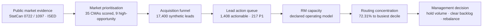
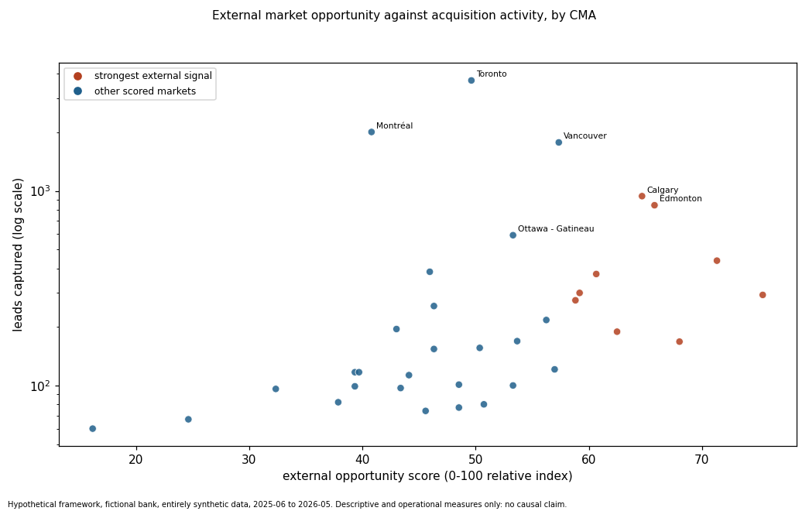
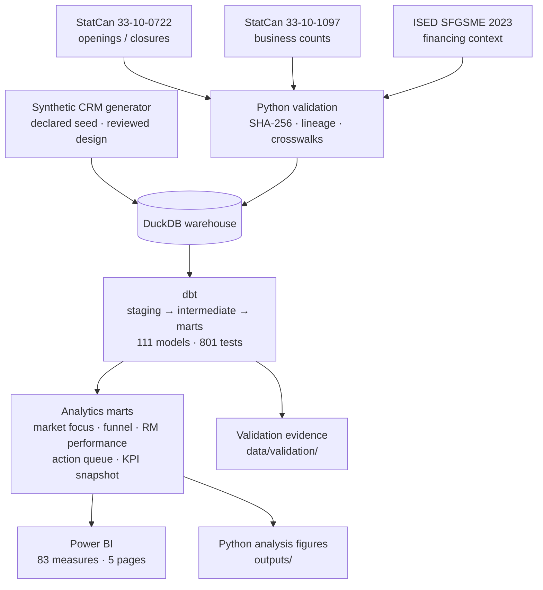

# SME Growth & Acquisition Intelligence

**Canadian SME acquisition opportunity is concentrated in nine markets — but the bank is already in all nine. The
constraint is not where to sell. It is that work piles up after the first conversation, and that routing quietly
sends most of it to the same few people.**

A portfolio case study combining public Canadian market evidence with a synthetic operational funnel to answer three
questions for a fictional business-banking team: where is SME acquisition opportunity strongest, which leads need
action now, and where does lead routing create operational risk?

> **Synthetic operational data.** The market evidence is real public data from Statistics Canada and ISED. The CRM,
> leads, relationship managers and outcomes are entirely synthetic, generated for this project. Nothing here is a
> claim about, or a benchmark for, any real Canadian bank.

### 90-second walkthrough

> **TODO — demo video not yet recorded.** A short Loom walkthrough of the five dashboard pages will be linked here.
> Until then, [What I found](#what-i-found) and the figures below cover the same ground.

---

## The decision

Stop treating this as a market-coverage problem and start treating it as a throughput and workload problem.

All nine high-opportunity markets already receive at or above the median lead volume, so there is no coverage gap to
close. Meanwhile 1,408 leads are waiting for action, qualification collapses right after first contact, and 72.31% of
routing recommendations land on the busiest 10% of relationship managers — even though the capacity rules record
**zero** breaches.

**Recommendation: hold acquisition volume flat, clear the backlog, fix the qualification step, and add a workload
distribution control alongside the existing hard cap.**

## What I found

**1. Opportunity is concentrated, and already covered.**
Nine of 35 scored census metropolitan areas carry a stronger external opportunity signal: Halifax, Winnipeg,
Saskatoon, Edmonton, Calgary, Windsor, Quebec, Kitchener–Cambridge–Waterloo and London. Every one of them already
receives at or above the median lead volume across scored CMAs. The count of high-opportunity markets below median
activity is **zero**.

**2. The funnel does not leak at intake. It leaks after the first conversation.**

| Stage | Leads | Rate |
|---|---:|---|
| Captured | 17,400 | — |
| Valid | 15,933 | 91.6% of captured |
| Assigned | 15,853 | **99.50%** of valid |
| Contacted | 14,278 | **90.1%** of assigned (14,278 / 15,853) |
| Qualified (mature cohort) | 3,683 | **27.82%** of mature contacted |
| Converted (mature cohort) | 1,511 | **12.52%** of mature valid (1,511 / 12,064) |

Intake, assignment and first contact all work. Between contact and qualification the funnel loses roughly three out
of four leads. That is where process attention belongs.

**3. There is a real backlog, and part of it is already late.**
1,408 leads need action now: 217 are P1, 213 require escalation, and the first-contact SLA breach rate is 13.15%.

**4. Capacity compliance and workload balance are not the same thing — and only one of them is healthy.**

| Measure | Value |
|---|---:|
| Operational hard-cap breaches | **0** |
| Share of recommendations to the busiest decile (14 of 140 RMs) | **72.31%** |
| Workload Gini | **0.773** |
| Recommendations to the single busiest RM | **3,216** |
| Median recommendations per RM | 35.5 |
| RMs receiving no recommendations | **8** |

The routing rules respect the hard limit on every single decision. They still produce a distribution where one
person receives roughly 90 times the median workload and eight people receive nothing.

The cause is in the rules themselves: the preference logic rewards the emptiest available relationship manager, and
in a lightly loaded year that is repeatedly the same person. A hard cap is a ceiling, not a distribution policy.


## Why this matters

A capacity dashboard reporting "zero breaches" would tell this management team that routing is under control. It
isn't. The control that exists prevents individual overload; nothing in the system spreads work across the network.

The practical consequences are concrete: eight relationship managers are idle on recommendations while one carries
thousands, and the leads sitting behind that concentration are the 1,408 already waiting. Adding more acquisition
volume into this system increases the backlog without increasing conversion.

## The problem

A business-banking team wants to grow its SME book. The usual framing is "find the best markets and send more
leads". That framing assumes two things worth testing: that market opportunity and current activity are
mismatched, and that the operational system can absorb more volume.

The stakeholders pull in different directions. Regional leadership wants market prioritisation. Sales management
wants a defensible answer to "who works which lead first". Operations owns SLAs and relationship-manager capacity
and is the group that absorbs any volume increase.

Those three questions cannot be answered from the same table. Market opportunity comes from public aggregates that
contain no customers. Lead priority and routing are operational and need record-level data that no public source
provides. Connecting them without inventing a relationship that does not exist is the actual analytical problem.

## How I approached it

The analytical decisions mattered more than the tooling. The ones that changed the answer:

**Separating market scale from market opportunity.** A large market is not the same as a market with momentum. The
opportunity framework scores 35 CMAs on five pillars — scale, momentum, dynamism, commercial fit and stability —
under transparent weighting scenarios, so a result can be tested against a different weighting rather than asserted.

**Reconciling incompatible public definitions.** The three sources count different things: 33-10-0722 counts
*enterprises*, 33-10-1097 counts *locations*, and ISED reports *survey estimates*. They are never combined in one
table and never used as each other's denominators. Each fact table carries its source, period and statistical unit
on every row.

**Resolving geography and size-band differences.** CMA boundaries differ between SGC 2016 (0722) and SGC 2021
(1097); they are aligned only through a reviewed, tested bridge. Six CMAs were census agglomerations in 2016 and
have scale and composition data only, so they are excluded from momentum comparison and carry **no** opportunity
score. A blank score means missing evidence — not zero opportunity.

**Keeping unresolved leads in the totals.** 2,112 of the 17,400 leads could not be resolved to a CMA. Dropping them
would have made every funnel rate look slightly better and quietly changed the denominator. They stay in the funnel
totals and are reported as their own line.

**Treating the opportunity score as a current planning snapshot.** It describes markets today and is never applied
retrospectively to historical leads. A dbt test asserts the score never appears in the monthly funnel, so the rule
is enforced rather than merely documented.

**Measuring qualification and conversion on mature cohorts only.** A lead captured last week has not failed to
convert; it has not had time. Conversion is reported only on cohorts given 90 days (95% of observed conversions land
within 93 days). Recent leads are excluded from the denominator rather than counted as failures — which is why
conversion is 1,511 of 12,064 *mature valid* leads, not 1,511 of 17,400.

**Preventing double counting by construction.** Status history reaches 12 rows per lead, SLA events 27, activities
19. Every mart reads one intermediate model that is one row per lead, so a lead is counted once structurally rather
than by careful joins.

**Separating capacity compliance from workload concentration.** These were deliberately measured as two different
things. Reporting only the first would have produced a clean and misleading result.

## From market signal to action



Each step narrows the question. Public evidence says where the market is; the funnel says what actually happened to
leads; the queue says what needs doing today; capacity and concentration say whether the team can absorb it.




## Key dashboard views

A five-page Power BI report sits on top of the marts: a 9-table model with 83 DAX measures and 61 visuals built
against a declared visual contract (`dashboard/power_bi/visual_specification.csv`).

> **TODO — page screenshots not yet captured.** The `.pbix` is in the repository and the layout wireframes are
> under `dashboard/power_bi/wireframes/`. Screenshots of the live pages will replace this note. The figures in this
> README are Python analysis outputs generated directly from the validated marts, not dashboard captures.

| Page | The decision it supports |
|---|---|
| Executive Overview | Is the acquisition system healthy right now, and if not, which part is failing? |
| Market Opportunity | Which markets deserve acquisition attention, and where is the evidence missing? |
| Acquisition Funnel | At which stage are leads actually lost, and is that stable over the year? |
| Lead Action Queue | Which specific leads should be worked first today? |
| RM Capacity & Routing | Can the team absorb more volume, and is the work spread fairly? |


## Key recommendations

1. **Hold acquisition volume flat in the nine high-opportunity markets.** They are already served at or above median
   activity. There is no coverage gap, so additional volume adds backlog rather than conversion.
2. **Clear the 1,408-lead backlog before expanding intake**, starting with the 217 P1 leads and the 213 requiring
   escalation. The first-contact SLA breach rate of 13.15% is the symptom to watch.
3. **Target the qualification step, not intake.** 90.1% of assigned leads are contacted; only 27.82% of mature
   contacted leads qualify. Intake and assignment are not the constraint.
4. **Report conversion on the mature cohort only.** Measuring against all leads mixes in leads that have not had
   time to convert and will understate performance by construction.
5. **Add a workload distribution measure to routing governance alongside the hard cap.** Zero breaches is being read
   as "routing is fine"; a Gini of 0.773 says otherwise. *Caveat:* the capacity ledger resets nightly from snapshots
   produced by the historical policy, so rebalancing is an untested next step here, not a demonstrated fix.
6. **Investigate the 8 relationship managers receiving no recommendations.** This is either a territory and
   specialist eligibility gap or a data gap. Either way it is unlikely to be intentional.

## Data and methodology

### Real / public sources

| Source | What it provides | Reference period |
|---|---|---|
| **Statistics Canada 33-10-0722-01** — Experimental estimates for business openings and closures | Monthly business openings and closures (enterprises) | 2015-01 to 2026-05 |
| **Statistics Canada 33-10-1097-01** — Canadian Business Counts, with employees | Business counts by location and size band (locations) | December 2025 |
| **ISED Survey on Financing and Growth of SMEs, 2023** | SME financing context (survey estimates) | 2023 |

`data/source_manifest.csv` records each raw file with its SHA-256, byte size, source title, source URL and reference
period. ISED estimates are contextual evidence only and are never used as market-size inputs or attached to CMAs.

### Synthetic data

The operational layer — **17,400 leads**, about 15,600 fictional business prospects, 140 relationship managers, and
their assignments, activities, SLA clocks, capacity snapshots, routing decisions and outcomes — is entirely
synthetic, deterministically generated from a declared seed over a simulated operating year (2025-06-01 to
2026-05-31).

**Why synthetic was necessary:** no public source contains bank CRM records, and none ever should. Lead
prioritisation and routing cannot be demonstrated on aggregates that contain no leads. Generating the operational
layer from a declared, reviewed design made the process rules explicit and testable, and keeps every operational
rate an openly stated simulation setting rather than an implied benchmark.

A validator checks that the synthetic data contains no real bank names, no real email domains, and no
social-insurance, business-number or account-number patterns.

## Data engineering and QA

**dbt on DuckDB**, 111 models and **801 tests**, organised in tag-isolated layers so each analytical stage can be
built and tested without disturbing the one before it:

| Layer | Tests |
|---|---:|
| Base analytical layer | 151 |
| Market opportunity | 39 |
| Synthetic CRM | 383 |
| Lead routing | 168 |
| Acquisition intelligence | 60 |

The pipeline runs `dbt test` for the base analytical layer: 151 dbt tests, then each later layer under its own tag.

Beyond the dbt tests, the project carries independent verification:

- **Reconciliation.** The dbt marts are compared against an earlier Python-built baseline of the same 11 relations,
  column by column and metric by metric.
- **Recalculation.** `src/validation/21_validate_acquisition_intelligence.py` recomputes every headline KPI from the
  source facts rather than reading the mart — 84 of 84 checks pass.
- **Mutation testing.** Key tests are re-run with a deliberately injected fault and must then fail, which proves the
  test is capable of failing.
- **Leakage proofs.** No outcome, later event or historical selected RM enters any priority score or routing
  recommendation. Verified by dbt manifest lineage, a column-level read check on the compiled SQL, independent
  recomputation and mutation tests.
- **Determinism.** Repeated runs produce byte-identical artefacts — relations, analysis files, figures and
  validation evidence.

Evidence for every check is written to `data/validation/` and committed.

**Power BI semantic layer:** 9 tables, 83 DAX measures, single-direction relationships, and a one-row-per-lead spine
so no measure fans out. Every measure carries its format and QA target in `dashboard/power_bi/measures.dax`.

> The dashboard QA checklist (`dashboard/power_bi/dashboard_qa_checklist.md`) is **not yet filled in**. The numbers
> in this README come from the validated data layer, not from the report.

## Architecture



## CRM acquisition process design

This is a **hypothetical design for a fictional bank**. It specifies a target-state SME acquisition process, CRM
requirements and control rules for lead prioritization and relationship-manager routing. Nothing in it describes the
internal process of any real Canadian bank, and the CRM data are entirely synthetic. Every SLA, capacity value,
duplicate rule and conversion outcome is a declared simulation setting.

- **Documents:** [docs/crm_acquisition_process_and_requirements.md](docs/crm_acquisition_process_and_requirements.md)
  and [docs/crm_data_model_and_dictionary.md](docs/crm_data_model_and_dictionary.md).
- **Design catalogs:** `data/design/crm/` — assumptions, stakeholder needs, channels, lead statuses and transitions,
  routing, territory, specialist, capacity, SLA and duplicate rules, the entity catalog and field dictionary, KPIs,
  requirements, acceptance criteria, traceability and synthetic scenarios. These are reviewed design inputs, not dbt
  seeds and not raw data.
- **Validation:** `src/validation/15_validate_crm_design.py`, with evidence in `data/validation/crm_design/`.

```powershell
powershell -ExecutionPolicy Bypass -File ./run_analytical_pipeline.ps1 -Scope CRMDesign
```

## Reproducing / exploring the project

**To explore without running anything** — everything needed is committed:

- Analysis outputs as CSV under `data/analysis/`, including the KPI snapshot and the action queue.
- All figures under `outputs/`.
- Validation evidence under `data/validation/`.
- The report at `dashboard/power_bi/SME Growth & Acquisition Intelligence.pbix`. Open it in Power BI Desktop and
  repoint the `DataRoot` parameter to your clone path before refreshing.

**To rebuild the analytical layers** — set up the two Python environments, copy `profiles.example.yml` to
`profiles.yml`, and run the pipeline. Full instructions are in
[docs/01_project_setup_and_pipeline.md](docs/01_project_setup_and_pipeline.md).

```bash
powershell -ExecutionPolicy Bypass -File ./run_analytical_pipeline.ps1
```

**To rebuild from raw source data** — `data/raw/` is not committed (the 0722 table alone is 1.69 GB). Download the
three sources from the URLs in `data/source_manifest.csv`. Statistics Canada revises its tables, so a download made
later than the original may not match the recorded SHA-256 hashes; treat a mismatch as a source revision to be
reviewed, not as something to override.

## Limitations

- **The operational data is synthetic.** Every lead, relationship manager, SLA, capacity value and conversion
  outcome is generated. No operational rate here is a benchmark for any real institution.
- **The opportunity score is a current planning construct**, not a forecast and not a historical attribute. It
  excludes bank market share, branch presence, competition, credit risk and acquisition cost.
- **Nothing here is causal.** Comparisons against the synthetic historical assignments measure rule adherence and
  operational exposure. They are not evidence of an effect on conversion, revenue, profitability or customer
  experience.
- **Capacity is a declared operating model**, not a measurement of real employee workload.
- **Routing rebalancing is unproven.** The capacity ledger enforces the hard limit within a snapshot window but
  resets nightly from snapshots produced by the historical policy, so it barely changes year-long concentration.
  This layer should not be presented as a workload-balancing solution.
- **The sources share no common period** — 0722 is monthly to 2026-05, 1097 is a December 2025 snapshot, ISED covers
  2023 — and they are never joined on time.
- **Suppressed and unavailable observations stay NULL**, never zero. A 1097 cell counts as zero only where
  reconciliation proves it.
- **Six CMAs carry no opportunity score**, and 2,112 leads could not be resolved to a CMA. Both are reported rather
  than hidden.
- **Documents in `docs/` record their own layer at the stage it was built**, so an early document may describe a
  later layer as not yet existing. This README reflects the current state of the project.

## Repository structure

```
├── models/            dbt: staging → intermediate → marts (111 models)
├── tests/             dbt singular tests (79 files)
├── seeds/             reviewed configuration: weights, rules, thresholds, KPI catalog
├── macros/            shared dbt macros
├── src/
│   ├── validation/    source validation, reconciliation, layer validators, mutation tests
│   ├── analysis/      statistical exploration and figure generation
│   ├── analytics/     the Python baseline the dbt marts are reconciled against
│   └── synthetic/     the deterministic synthetic CRM generator
├── data/
│   ├── reference/     reviewed crosswalks (loaded as dbt seeds)
│   ├── design/crm/    the reviewed CRM process design catalogs
│   ├── synthetic/     generated CRM tables (Parquet) + ground truth
│   ├── analysis/      analysis outputs consumed by Power BI
│   ├── validation/    committed evidence for every validation run
│   └── source_manifest.csv
├── outputs/           analysis figures (PNG)
├── dashboard/power_bi/  .pbix, 83 measures, visual contract, build kit, wireframes
├── docs/              methodology and layer documentation
└── run_analytical_pipeline.ps1
```

## Tools

SQL · dbt (dbt-core 1.12.5, dbt-duckdb) · DuckDB · Power BI (DAX, Power Query) · Python (pandas, matplotlib) ·
PowerShell · Statistics Canada and ISED open data

## Licence and attribution

Code and documentation in this repository are released under the [MIT Licence](LICENSE).

This project is a value-added product that adapts public information:

- Adapted from Statistics Canada, *Experimental estimates for business openings and closures by employment size for
  Canada, provinces and territories, census metropolitan areas, seasonally adjusted* (Table 33-10-0722-01),
  reference period 2015-01 to 2026-05. This does not constitute an endorsement by Statistics Canada of this product.
- Adapted from Statistics Canada, *Canadian Business Counts, with employees, census metropolitan areas and census
  subdivisions, December 2025* (Table 33-10-1097-01). This does not constitute an endorsement by Statistics Canada
  of this product.
- Adapted from *Survey on Financing and Growth of Small and Medium Enterprises, 2023*, produced by Statistics Canada
  in collaboration with Innovation, Science and Economic Development Canada. This does not constitute an endorsement
  by Statistics Canada of this product.

Contains information licensed under the
[Open Government Licence – Canada](https://open.canada.ca/en/open-government-licence-canada).

See [ATTRIBUTION.md](ATTRIBUTION.md) for full source details.
