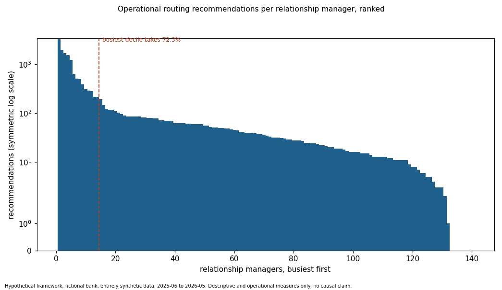
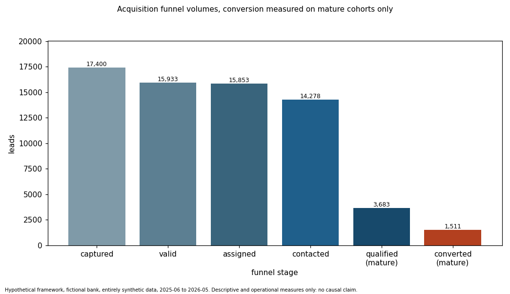
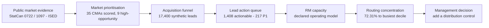
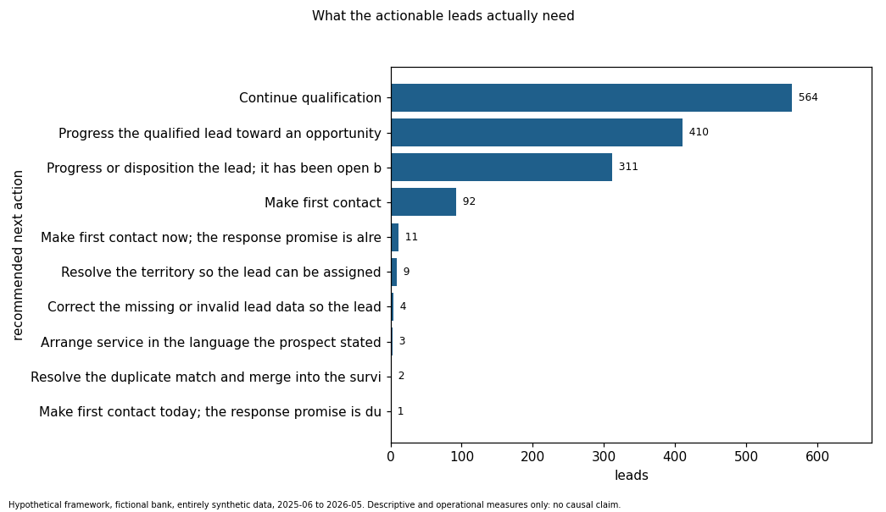
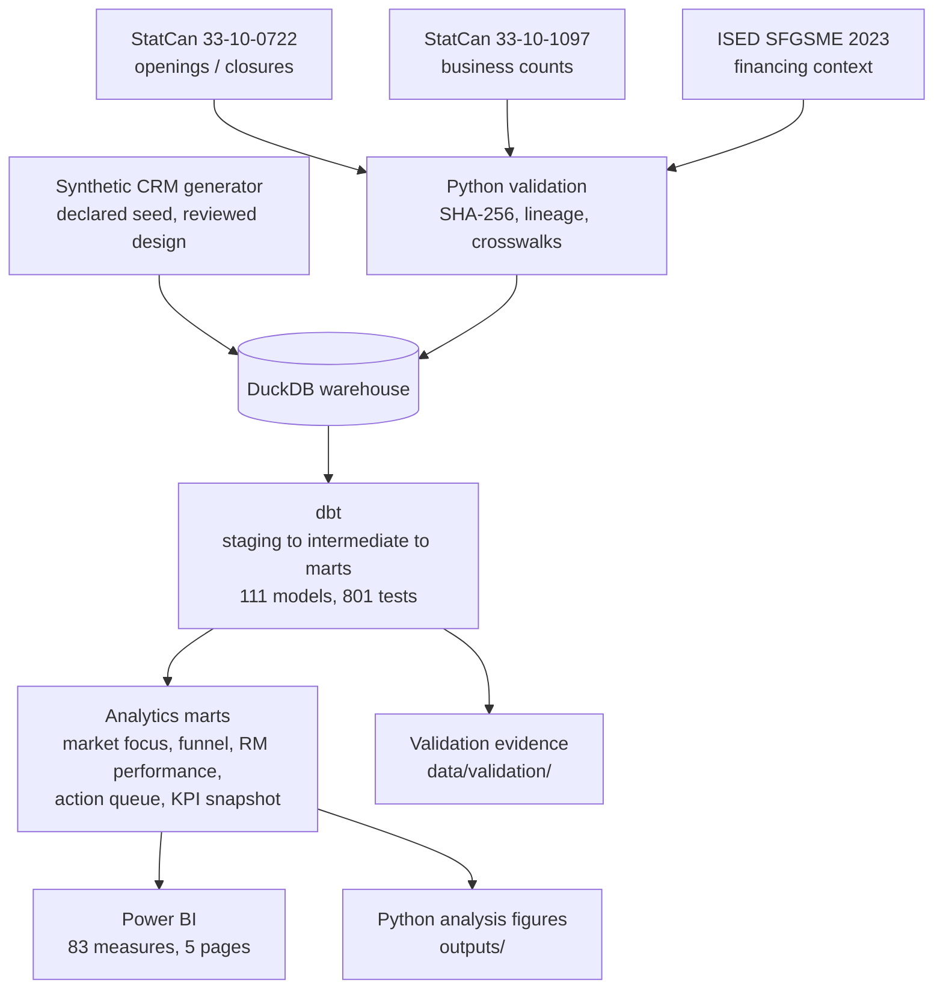

# AI-Assisted SME Growth & Lead Routing

**A lead-routing rule set can be provably compliant and still be badly broken. In this build the capacity rules
record zero breaches — and send 72.31% of all recommendations to the busiest 10% of relationship managers, while
six others are structurally invisible to the router.**

A portfolio case study for a fictional Canadian business-banking team. It combines real public market evidence with
a synthetic operational funnel to answer three questions: where is SME acquisition opportunity strongest, which
leads need action now, and where does routing create operational risk?

> **Read this before the numbers.** The market evidence is real public data from Statistics Canada and ISED. The
> CRM — leads, relationship managers, SLAs, capacity and outcomes — is **entirely synthetic**, generated for this
> project. Nothing here is a claim about, or a benchmark for, any real Canadian bank.

### 90-second walkthrough

> **TODO — demo video not yet recorded.** A short walkthrough of the five dashboard pages will be linked here.
> Until then, [What I found](#what-i-found) covers the same ground.

---

## The decision

**Add a workload distribution control to lead routing. The hard cap alone is not governance.**

A capacity report that says "zero breaches" reads as "routing is under control". In this build it isn't. The same
rule set that never once exceeded a relationship manager's hard limit also produced a workload Gini of 0.773, sent
3,216 recommendations to one person against a median of 35.5, and gave eight people none at all.

The mechanism is not a bug. The preference rules reward the emptiest available relationship manager, and in a
lightly loaded period that is repeatedly the same person. **A hard cap is a ceiling. It is not a distribution
policy, and nothing else in the rule set is doing that job.**

## What is evidence and what is simulation

This distinction matters more than any single number, so it comes before the findings rather than after them.

| | Status | What it supports |
|---|---|---|
| Market opportunity ranking across 35 CMAs | **Real public data** (StatCan, ISED) | Which markets carry the stronger external signal |
| Routing concentration and capacity compliance | **Design result** — emerges from the declared rule set applied to a simulated workload | That compliance and distribution are different properties |
| All funnel rates, lead volumes and conversion outcomes | **Simulation settings** | How the measurement framework behaves; *not* business findings |

The generator distributes leads across markets in proportion to business counts (Spearman 0.99 against the scale
pillar) and explicitly simulates **no** market-context effect on outcomes. So any apparent relationship between a
market's opportunity score and its funnel performance is an artifact of construction, and this project does not
claim one.

## What I found

**1. External opportunity is genuinely concentrated.** *(real data)*

Nine of 35 scored census metropolitan areas carry a stronger external opportunity signal: Halifax, Winnipeg,
Saskatoon, Edmonton, Calgary, Windsor, Quebec, Kitchener–Cambridge–Waterloo and London. Six further CMAs carry
**no** score at all — they were census agglomerations under SGC 2016 and have scale data only. Their blank is
missing evidence, not zero opportunity, and the framework refuses to rank them.

**2. Compliance and distribution are different properties, and only one was being measured.** *(design result)*

| Measure | Value |
|---|---:|
| Operational hard-cap breaches | **0** |
| Share of recommendations to the busiest decile (14 of 140 RMs) | **72.31%** |
| Workload Gini | **0.773** |
| Recommendations to the single busiest RM | **3,216** |
| Median recommendations per RM | 35.5 |
| RMs receiving no recommendations | **8** |

Every one of the 19,777 routing decisions respected the hard limit. The distribution is still extreme.

*(The 3,216 figure counts recommendations across the year, not a workload one person held at once — the capacity
ledger resets nightly, which is exactly why the cap never tripped.)*



**3. Six of the eight excluded relationship managers are invisible by data, not by decision.** *(design result)*

Of the 8 RMs receiving no recommendations, **6 have no capacity snapshot at all** — RM-0009, RM-0010, RM-0028,
RM-0030, RM-0055 and RM-0057. Routing reads capacity from the most recent snapshot at or before each decision, so an
RM with no snapshot can never be selected. They were not passed over; they were never candidates.

Only 2 RMs were genuinely eligible and simply never chosen. That reframes the fix: this is a **data-feed** problem
first, and a preference-weighting problem second.

**4. The measurement framework separates "has not converted yet" from "did not convert."** *(framework behaviour)*

| Stage | Leads | Rate |
|---|---:|---|
| Captured | 17,400 | — |
| Valid | 15,933 | 91.6% of captured |
| Assigned | 15,853 | 99.50% of valid |
| Contacted | 14,278 | 90.1% of assigned |
| Qualified (mature cohort) | 3,683 | 27.82% of mature contacted |
| Converted (mature cohort) | 1,511 | 12.52% of mature valid (1,511 / 12,064) |

Conversion is reported only on cohorts given 90 days to convert. Measured naively against all 17,400 leads it would
read 8.7% — understating performance by counting leads that simply have not had time. The 5,336-lead gap between
the two denominators is the entire point of the maturity rule.

These rates are simulation settings. What they demonstrate is that the framework reports them honestly.



**5. The operational queue is real work, surfaced rather than aggregated away.**

1,408 leads require action: 217 are P1, 213 require escalation, 7 are unassigned and 19 sit in controlled queues.
The first-contact SLA breach rate is 13.15%.

## Why this matters

The reporting failure here is the interesting part. A dashboard showing "0 breaches" against a declared capacity
limit is factually correct and operationally misleading. It answers "is anyone overloaded?" and is read as
answering "is the work spread sensibly?" — a different question that nothing in the rule set addresses.

Two concrete consequences follow. Eight relationship managers receive no routed work, six of them because of a
missing data feed nobody would notice from a compliance report. And a rule set that looks governed by its own
metrics has no distribution control at all.

That generalises past this build: **any ceiling-only control will pass its own test while the thing it was meant to
protect goes unmeasured.**

## The problem

A business-banking team wants to grow its SME book. The usual framing is "find the best markets and send more
leads", which assumes the operational system can absorb the volume.

The stakeholders pull in different directions. Regional leadership wants market prioritisation. Sales management
wants a defensible answer to "who works which lead first". Operations owns SLAs and relationship-manager capacity
and absorbs any volume increase.

Those questions cannot be answered from one table. Market opportunity comes from public aggregates containing no
customers. Lead priority and routing need record-level data no public source provides. Connecting the two without
inventing a relationship that does not exist is the actual analytical problem — and the reason the operational
layer is openly synthetic rather than quietly inferred.

## How I approached it

The analytical decisions mattered more than the tooling.

**Separating market scale from market opportunity.** A large market is not a market with momentum. The framework
scores 35 CMAs on five pillars — scale, momentum, dynamism, commercial fit and stability — under transparent
weighting scenarios, so a ranking can be tested against a different weighting rather than asserted.

**Reconciling incompatible public definitions.** The sources count different things: 33-10-0722 counts
*enterprises*, 33-10-1097 counts *locations*, ISED reports *survey estimates*. They are never combined in one table
and never used as each other's denominators. Each fact table carries its source, period and statistical unit on
every row.

**Resolving geography and size-band differences.** CMA boundaries differ between SGC 2016 and SGC 2021 and are
aligned only through a reviewed, tested bridge. Six CMAs have scale data only and are excluded from momentum
comparison, carrying no opportunity score rather than a misleading one.

**Keeping unresolved leads in the totals.** 2,112 of the 17,400 leads could not be resolved to a CMA. Dropping them
would have improved every funnel rate and quietly changed the denominator. They stay in the totals and are reported
as their own line.

**Treating the opportunity score as a current planning snapshot.** It describes markets today and is never applied
retrospectively. A dbt test asserts the score never appears in the monthly funnel, so the rule is enforced rather
than documented.

**Measuring on mature cohorts.** Recent leads are excluded from the denominator rather than counted as failures.

**Preventing double counting by construction.** Status history reaches 12 rows per lead, SLA events 27, activities
19. Every mart reads one intermediate model that is one row per lead, so a lead is counted once structurally rather
than by careful joins.

**Measuring capacity compliance and workload concentration as two separate things.** Reporting only the first would
have produced a clean, defensible and completely misleading result. This single decision produced the project's
main finding.

## From market signal to action



Each step narrows the question. Public evidence says where the market is; the funnel says what happened to leads;
the queue says what needs doing today; capacity and concentration say whether the team can absorb it.



## Key dashboard views

A five-page Power BI report sits on the marts: a 9-table model, 83 measures defined in `measures.dax`, and 60 of
the 61 visuals in the declared visual contract (`dashboard/power_bi/visual_specification.csv`). One card is
outstanding and one map was substituted with a treemap — see [Limitations](#limitations).

> **TODO — page screenshots not yet captured.** The `.pbix` is in the repository and layout wireframes are under
> `dashboard/power_bi/wireframes/`. The figures in this README are Python analysis outputs generated directly from
> the validated marts, not dashboard captures.

| Page | The decision it supports |
|---|---|
| Executive Overview | Is the acquisition system healthy right now, and if not, which part is failing? |
| Market Opportunity | Which markets carry the stronger signal, and where is the evidence missing? |
| Acquisition Funnel | At which stage are leads lost, and is that stable across the year? |
| Lead Action Queue | Which specific leads should be worked first today? |
| RM Capacity & Routing | Can the team absorb more volume, and is the work spread across the network? |

## Key recommendations

1. **Add a workload distribution measure to routing governance alongside the hard cap.** Zero breaches is being
   read as "routing is fine"; a Gini of 0.773 and eight idle RMs say otherwise. Track distribution as a first-class
   control, not a diagnostic.
2. **Fix the capacity feed before touching the preference weights.** Six of the eight excluded RMs have no capacity
   snapshot and cannot be selected at all. No amount of weight tuning reaches them.
3. **Work the 1,408-lead backlog by priority**, starting with the 217 P1 leads and the 213 requiring escalation.
   The 13.15% first-contact SLA breach rate is the symptom to monitor.
4. **Report conversion on the mature cohort only.** The naive measure reads 8.7% against 12.52% purely from
   denominator choice. Publishing the wrong one would misstate performance by a third.
5. **Treat the nine high-opportunity CMAs as a prioritisation input, not a target list.** The opportunity score
   excludes market share, branch presence, competition, credit risk and acquisition cost; it says where the external
   signal is strong, not where this bank should invest.
6. **Do not interpret the capacity ledger as a rebalancing solution.** It enforces the limit within a snapshot
   window but resets nightly from snapshots produced by the historical policy, so it barely moves year-long
   concentration. Rebalancing is an untested next step, not a demonstrated fix.

## Data and methodology

### Real / public sources

| Source | What it provides | Reference period |
|---|---|---|
| **Statistics Canada 33-10-0722-01** — Experimental estimates for business openings and closures | Monthly openings and closures (enterprises) | 2015-01 to 2026-05 |
| **Statistics Canada 33-10-1097-01** — Canadian Business Counts, with employees | Business counts by location and size band (locations) | December 2025 release, reference date July 2025 |
| **ISED Survey on Financing and Growth of SMEs, 2023** | SME financing context (survey estimates) | Survey year 2023 |

`data/source_manifest.csv` records each raw file with its SHA-256, byte size, source title, source URL and reference
period. ISED estimates are contextual evidence only — never market-size inputs, never attached to CMAs.

### Synthetic data

The operational layer — **17,400 leads**, about 15,600 fictional prospects, 140 relationship managers and their
assignments, activities, SLA clocks, capacity snapshots, routing decisions and outcomes — is entirely synthetic,
generated deterministically from a declared seed over a simulated operating year (2025-06-01 to 2026-05-31).

**Why synthetic was necessary:** no public source contains bank CRM records, and none should. Lead prioritisation
and routing cannot be demonstrated on aggregates containing no leads. Generating the layer from a reviewed, declared
design made every process rule explicit and testable, and keeps each operational rate an openly stated simulation
setting rather than an implied benchmark.

Every generation parameter is catalogued in `data/design/crm/synthetic_generation_parameters.csv` and marked
`simulation setting; not approved production policy`. A validator checks the generated data contains no real bank
names, no real email domains, and no social-insurance, business-number or account-number patterns.

## Data engineering and QA

**dbt on DuckDB**, 111 models and **801 tests**, in tag-isolated layers so each stage builds and tests without
disturbing the one before it:

| Layer | Tests |
|---|---:|
| Base analytical layer | 151 |
| Market opportunity | 39 |
| Synthetic CRM | 383 |
| Lead routing | 168 |
| Acquisition intelligence | 60 |

The pipeline runs `dbt test` for the base analytical layer: 151 dbt tests, then each later layer under its own tag.

Beyond the dbt tests:

- **Reconciliation.** The dbt marts are compared against an earlier Python-built baseline of the same 11 relations,
  column by column and metric by metric — 965 metric checks.
- **Recalculation.** `src/validation/21_validate_acquisition_intelligence.py` recomputes every headline KPI from the
  source facts rather than reading the mart: 84 of 84 checks.
- **Mutation testing.** Key tests are re-run with a deliberately injected fault and must then fail, proving the test
  is capable of failing.
- **Leakage proofs.** No outcome, later event or historical selected RM enters any priority score or routing
  recommendation. Verified by dbt manifest lineage, a column-level read check on the compiled SQL, independent
  recomputation and mutation tests.
- **Determinism.** Repeated runs produce byte-identical artefacts.

Evidence for every check is committed under `data/validation/`.

**Power BI semantic layer:** 9 tables, single-direction relationships, and a one-row-per-lead spine so no measure
fans out. Every measure carries its format and QA target in `dashboard/power_bi/measures.dax`.

> The dashboard QA checklist (`dashboard/power_bi/dashboard_qa_checklist.md`) is **not yet filled in**. Every number
> in this README comes from the validated data layer, not from the report.

## Architecture



## Documentation

| Document | Content |
|---|---|
| [docs/01_project_setup_and_pipeline.md](docs/01_project_setup_and_pipeline.md) | Environment setup, local profile, pipeline runbook |
| [docs/02_data_sources_and_validation.md](docs/02_data_sources_and_validation.md) | Source validation and crosswalks |
| [docs/03_mvp_analytical_scope.md](docs/03_mvp_analytical_scope.md) | Analytical scope, reporting spine and grains |
| [docs/04_analytical_data_layer.md](docs/04_analytical_data_layer.md) | The 11 analytical relations and their rules |
| [docs/05_external_market_exploration.md](docs/05_external_market_exploration.md) | Descriptive market exploration and candidate indicators |
| [docs/dbt_transformation_layer.md](docs/dbt_transformation_layer.md) | dbt layer, tests and reconciliation |
| [docs/market_opportunity_framework.md](docs/market_opportunity_framework.md) | Indicators, scenarios, scores, sensitivity and limitations |
| [docs/crm_acquisition_process_and_requirements.md](docs/crm_acquisition_process_and_requirements.md) | The hypothetical CRM process: statuses, routing, SLAs, capacity, KPIs |
| [docs/crm_data_model_and_dictionary.md](docs/crm_data_model_and_dictionary.md) | Logical CRM data model, entity catalog and field dictionary |
| [docs/synthetic_crm_data.md](docs/synthetic_crm_data.md) | Synthetic data: generation, coverage, validation, reproducibility |
| [docs/lead_prioritization_and_routing.md](docs/lead_prioritization_and_routing.md) | Priority score, bands, eligibility, capacity, queues and validation |
| [docs/acquisition_intelligence_and_kpis.md](docs/acquisition_intelligence_and_kpis.md) | The five marts, the maturity rule, the KPI catalog, concentration risk |

Each document records its own layer at the stage it was built, so an early document may describe a later layer as
not yet existing. This README reflects the current state.

## CRM acquisition process design

This is a **hypothetical design for a fictional bank**. It specifies a target-state SME acquisition process, CRM
requirements and control rules for lead prioritization and relationship-manager routing. Nothing in it describes the
internal process of any real Canadian bank, and the CRM data are entirely synthetic. Every SLA, capacity value,
duplicate rule and conversion outcome is a declared simulation setting.

- **Documents:** [docs/crm_acquisition_process_and_requirements.md](docs/crm_acquisition_process_and_requirements.md)
  and [docs/crm_data_model_and_dictionary.md](docs/crm_data_model_and_dictionary.md).
- **Design catalogs:** `data/design/crm/` — assumptions, stakeholder needs, channels, lead statuses and transitions,
  routing, territory, specialist, capacity, SLA and duplicate rules, the entity catalog and field dictionary, KPIs,
  requirements, acceptance criteria, traceability and synthetic scenarios. Reviewed design inputs, not dbt seeds and
  not raw data.
- **Validation:** `src/validation/15_validate_crm_design.py` (202 checks), evidence in `data/validation/crm_design/`.

```powershell
powershell -ExecutionPolicy Bypass -File ./run_analytical_pipeline.ps1 -Scope CRMDesign
```

## Reproducing / exploring the project

**Explore — works straight from a clone.** Everything needed to inspect the results is committed:

```bash
git clone https://github.com/Abhijit2409/ai_assisted_sme_growth_lead_routing.git
```

- Analysis outputs as CSV under `data/analysis/`, including the KPI snapshot and the full action queue.
- All figures under `outputs/`.
- Validation evidence under `data/validation/`.
- The report at `dashboard/power_bi/SME Growth & Acquisition Intelligence.pbix`. Open it in Power BI Desktop and
  repoint the `DataRoot` parameter to your clone path before refreshing.

**Rebuild — requires the source downloads first.** `data/raw/` and `data/cache/` are **not** committed; the 0722
table alone is 1.69 GB. A fresh clone therefore cannot run the pipeline until you:

1. Download the three sources from the URLs in `data/source_manifest.csv`;
2. Build the Parquet cache with the validation layer, which checks each file's SHA-256 against the manifest;
3. Set up the two Python environments and copy `profiles.example.yml` to `profiles.yml`;
4. Run the pipeline.

```bash
powershell -ExecutionPolicy Bypass -File ./run_analytical_pipeline.ps1
```

Statistics Canada revises its tables, so a download made later than the original may not match the recorded hashes.
Treat a mismatch as a source revision to review, not something to override. Full instructions are in
[docs/01_project_setup_and_pipeline.md](docs/01_project_setup_and_pipeline.md).

## Limitations

- **The operational data is synthetic.** Every lead, relationship manager, SLA, capacity value and conversion
  outcome is generated. No operational rate here is a benchmark for any real institution.
- **Lead volume per market is a construction, not an observation.** The generator allocates leads in proportion to
  business counts and simulates no market-context effect on outcomes, so no relationship between a market's
  opportunity score and its funnel performance can be read from this data.
- **The opportunity score is a current planning construct**, not a forecast and not a historical attribute. It
  excludes market share, branch presence, competition, credit risk and acquisition cost.
- **Nothing here is causal.** Comparisons against the synthetic historical assignments measure rule adherence and
  operational exposure only.
- **Capacity is a declared operating model**, not a measurement of real employee workload.
- **Routing rebalancing is unproven**, for the reason given in recommendation 6.
- **The sources share no common period** and are never joined on time.
- **Suppressed and unavailable observations stay NULL**, never zero.
- **Six CMAs carry no opportunity score**, and 2,112 leads could not be resolved to a CMA. Both are reported.
- **The dashboard is 60 of 61 specified visuals.** The "high-opportunity markets below median activity" card is
  outstanding, and the CMA map was substituted with a treemap. Pages 2–5 use a 1920×1080 canvas while page 1 uses
  1280×720; all pages are 16:9 and scale to fit, but the mismatch is cosmetic debt.

## Repository structure

```
├── models/              dbt: staging → intermediate → marts (111 models)
├── tests/               dbt singular tests (79 files)
├── seeds/               reviewed configuration: weights, rules, thresholds, KPI catalog
├── macros/              shared dbt macros
├── src/
│   ├── validation/      source validation, reconciliation, layer validators, mutation tests
│   ├── analysis/        statistical exploration and figure generation
│   ├── analytics/       the Python baseline the dbt marts are reconciled against
│   └── synthetic/       the deterministic synthetic CRM generator
├── data/
│   ├── reference/       reviewed crosswalks (loaded as dbt seeds)
│   ├── design/crm/      the reviewed CRM process design catalogs
│   ├── synthetic/       generated CRM tables (Parquet) + ground truth
│   ├── analysis/        analysis outputs consumed by Power BI
│   ├── validation/      committed evidence for every validation run
│   └── source_manifest.csv
├── outputs/             analysis figures (PNG)
├── dashboard/power_bi/  .pbix, measures, visual contract, build kit, wireframes
├── docs/                methodology and layer documentation
└── run_analytical_pipeline.ps1
```

## Tools

SQL · dbt (dbt-core 1.12.5, dbt-duckdb) · DuckDB · Power BI (DAX, Power Query) · Python (pandas, matplotlib) ·
PowerShell · Statistics Canada and ISED open data

## Licence and attribution

Code and documentation are released under the [MIT Licence](LICENSE).

This project is a value-added product that adapts public information:

- Adapted from Statistics Canada, *Experimental estimates for business openings and closures by employment size for
  Canada, provinces and territories, census metropolitan areas, seasonally adjusted* (Table 33-10-0722-01),
  reference period 2015-01 to 2026-05. This does not constitute an endorsement by Statistics Canada of this product.
- Adapted from Statistics Canada, *Canadian Business Counts, with employees, census metropolitan areas and census
  subdivisions, December 2025* (Table 33-10-1097-01), December 2025 release, reference date July 2025. This does not
  constitute an endorsement by Statistics Canada of this product.
- Adapted from *Survey on Financing and Growth of Small and Medium Enterprises, 2023*, produced by Statistics Canada
  in collaboration with Innovation, Science and Economic Development Canada. This does not constitute an endorsement
  by Statistics Canada of this product.

Contains information licensed under the
[Open Government Licence – Canada](https://open.canada.ca/en/open-government-licence-canada).

See [ATTRIBUTION.md](ATTRIBUTION.md) for full source details.
