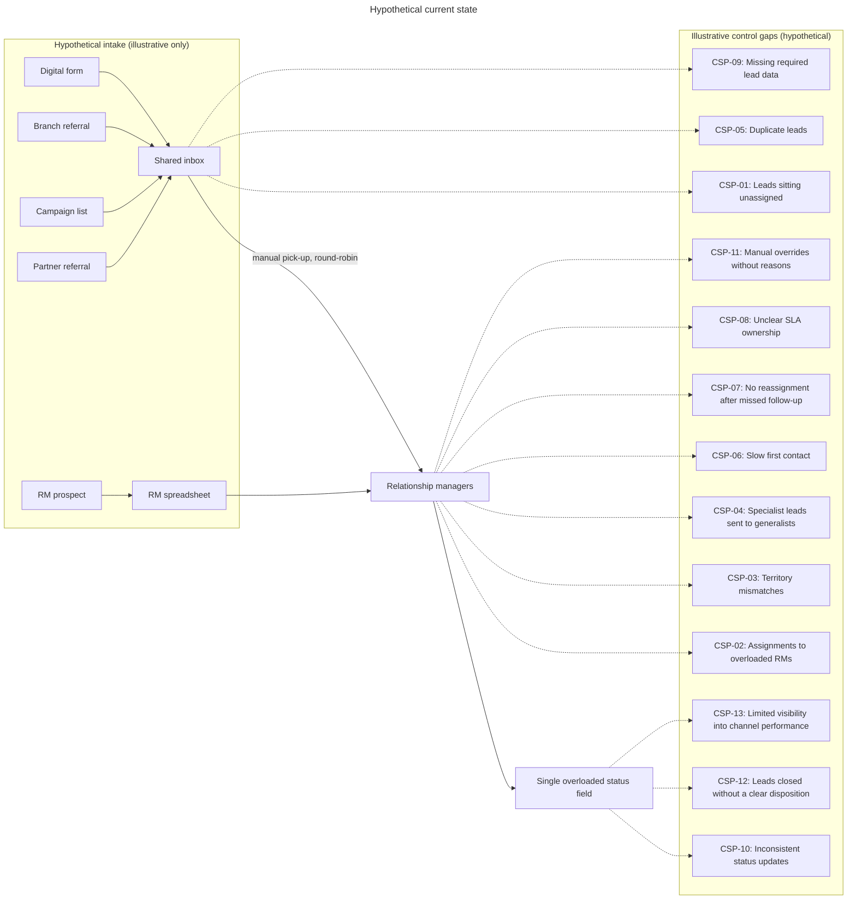
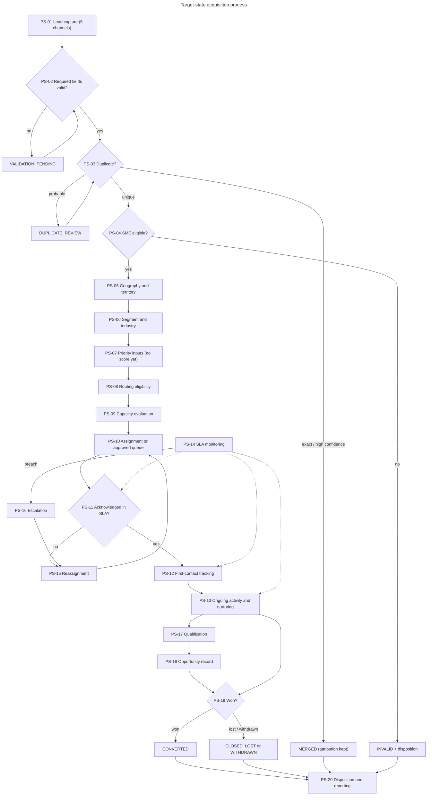
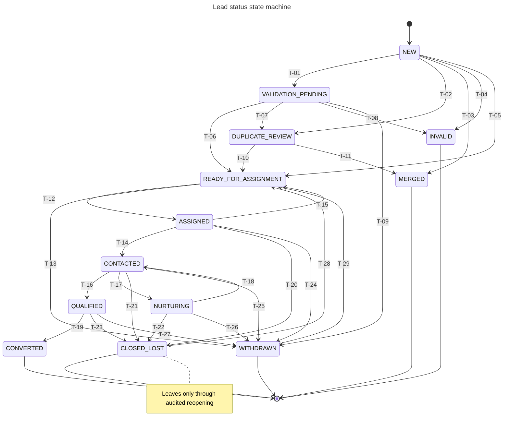
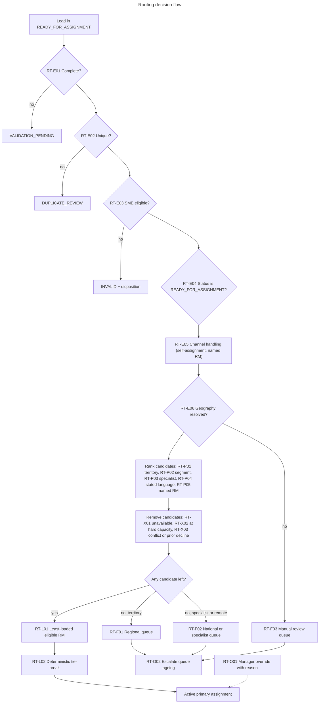
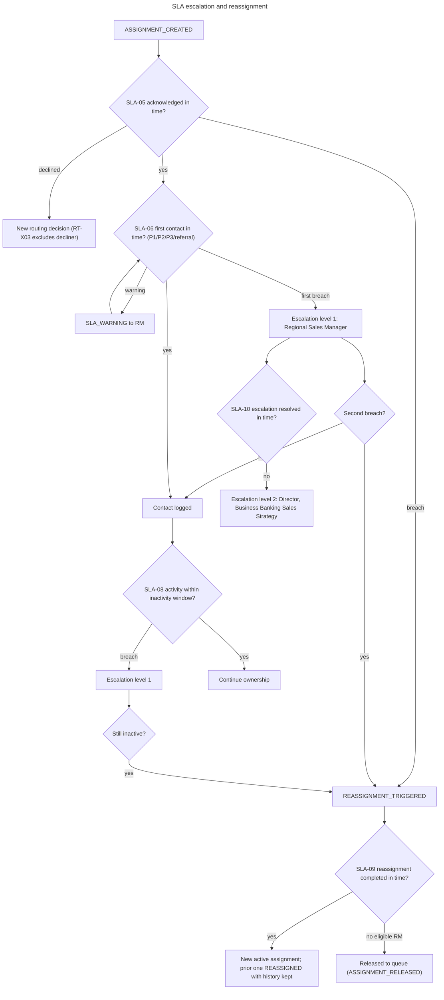

# CRM acquisition process and requirements

> **Hypothetical design for a fictional bank.** Everything in this document that describes a bank's internal CRM process, including current-state problems, SLAs, capacity limits, routing practices, specialist coverage and CRM behaviour, is a hypothetical current-state scenario, an illustrative control gap, a proposed target-state rule, a synthetic process assumption or a configurable business rule. None of it is a statement of fact about any real Canadian bank. The later CRM data will be entirely synthetic and will contain no real customer, employee, business, contact or banking information. All examples are fictional.

This document specifies a target-state acquisition process for Canadian SME prospects, the business requirements for the CRM that
would support it, the control rules for routing, SLAs, capacity and duplicates, the KPI tree and the synthetic scenarios the
later synthetic dataset must contain. It connects the external market opportunity framework
([market_opportunity_framework.md](market_opportunity_framework.md)) to future lead prioritization and relationship-manager (RM)
routing. The logical data model and field dictionary are in [crm_data_model_and_dictionary.md](crm_data_model_and_dictionary.md).

**What this design does not include:** synthetic CRM records, CRM dbt models, a lead-priority score, a routing score or
optimizer, dashboards, machine-learning models or production integration. These come later and will be built against the
catalogs referenced here.

All catalogs live in `data/design/crm/` and are validated by `src/validation/15_validate_crm_design.py` (evidence in
`data/validation/crm_design/`). Every count in this document is reproduced from those catalogs by the validator.

## 1. Stakeholders

The primary stakeholder is the **Director, Business Banking Sales Strategy**, who owns acquisition operating standards, lead
policy, routing principles, SLA expectations, capacity rules, performance reporting and the use of market opportunity insights.
Secondary stakeholders: Regional Sales Manager, Relationship Manager, Marketing, Branch teams, Partner-management teams,
CRM and Technology, and Data and Analytics.

| Need | Stakeholder | Need statement | Requirements |
|---|---|---|---|
| SN-001 | Director, Business Banking Sales Strategy | Approve and enforce acquisition operating standards, lead policy, routing principles, SLAs and capacity rules through versioned configuration. | BR-001;BR-002;BR-003;BR-004;BR-005;BR-006;BR-007;BR-008;BR-009;BR-010;BR-011;BR-012;DR-008 |
| SN-002 | Director, Business Banking Sales Strategy | See acquisition performance by channel, market, segment and RM network with consistent KPI definitions. | BR-001;BR-002;BR-003;BR-004;BR-005;BR-006;BR-007;BR-008;BR-009;BR-010;BR-011;BR-012;DR-008 |
| SN-003 | Director, Business Banking Sales Strategy | Know that every lead has a clear owner and that exceptions (overrides, escalations, breaches) are controlled and auditable. | BR-001;BR-002;BR-003;BR-004;BR-005;BR-006;BR-007;BR-008;BR-009;BR-010;BR-011;BR-012;DR-008 |
| SN-004 | Regional Sales Manager | Regional workload visibility, unassigned-lead alerts, SLA-breach visibility and capacity exceptions. | BR-001;BR-003;BR-004;BR-006;FR-008;FR-009;FR-010;RR-001;RR-002;RR-003;NFR-003 |
| SN-005 | Regional Sales Manager | Controlled reassignment and override with recorded reasons, and an escalation queue. | BR-001;BR-003;BR-004;BR-006;FR-008;FR-009;FR-010;RR-001;RR-002;RR-003;NFR-003 |
| SN-006 | Relationship Manager | Clear ownership, complete lead information, manageable workload and transparent contact deadlines. | BR-001;BR-003;BR-004;BR-005;BR-011;BR-012;FR-006;FR-007;FR-012;FR-013;FR-014;FR-015;FR-016 |
| SN-007 | Relationship Manager | Territory and specialist alignment, and documented reasons when a lead is reassigned. | BR-001;BR-003;BR-004;BR-005;BR-011;BR-012;FR-006;FR-007;FR-012;FR-013;FR-014;FR-015;FR-016 |
| SN-008 | Marketing | Source and campaign attribution preserved through duplicates, with lead-quality, disposition and funnel feedback. | BR-007;BR-008;FR-002;RR-001 |
| SN-009 | Branch teams | Simple referral capture, visibility of referral status, ownership confirmation and disposition feedback. | BR-007;BR-010 |
| SN-010 | Partner-management teams | Partner-source tracking, referral acknowledgement, consistent intake standards and outcome visibility. | BR-008;BR-010 |
| SN-011 | CRM and Technology | Entity definitions, required fields, status-transition rules, decision tables, timestamps, audit and acceptance criteria. | BR-002;FR-001;FR-003;FR-005;FR-011;DR-003;RR-005;NFR-002;NFR-005;NFR-006 |
| SN-012 | Data and Analytics | Stable grains and keys, event history, source lineage, reliable timestamps, configurable rules and testable data-quality requirements. | BR-009;FR-004;FR-005;DR-001;DR-002;DR-004;DR-005;DR-006;DR-007;DR-008;DQ-001;DQ-002;DQ-003;DQ-004;DQ-005;DQ-006;RR-004;NFR-001;NFR-004 |

## 2. Hypothetical current state

The **13** hypothetical current-state problems below are illustrative control gaps used to motivate the design. They are
not observations of any real bank.



| ID | Problem | Hypothetical scenario | Target-state control |
|---|---|---|---|
| CSP-01 | Leads sitting unassigned | Hypothetical current-state scenario: web leads land in a shared inbox that nobody owns after hours. | Assignment SLA with queue ownership and alerts (SLA-04A, RT-F01) |
| CSP-02 | Assignments to overloaded RMs | Illustrative control gap: leads are assigned round-robin without regard to workload. | Hard capacity limit and workload balancing (CAP-06, RT-L02) |
| CSP-03 | Territory mismatches | Hypothetical current-state scenario: the referring branch's RM receives leads located in another region. | Territory resolution on SGC 2021 codes (TER-01, RT-P02) |
| CSP-04 | Specialist leads sent to generalists | Illustrative control gap: agriculture and commercial-real-estate prospects go to generalist RMs. | Mandatory and preferred specialist rules (SPC-01, SPC-02) |
| CSP-05 | Duplicate leads | Hypothetical current-state scenario: the same business arrives from a campaign and a branch and two RMs call it. | Tiered duplicate rules and merge with attribution preserved (DUP-01..DUP-08) |
| CSP-06 | Slow first contact | Illustrative control gap: first contact is not time-stamped, so delays are invisible. | First-contact SLA with warning and breach events (SLA-06A..D) |
| CSP-07 | No reassignment after missed follow-up | Hypothetical current-state scenario: a lead stays with an RM on leave for weeks. | Automatic reassignment on acknowledgement breach and unavailability (SLA-05, CAP-08) |
| CSP-08 | Unclear SLA ownership | Illustrative control gap: nobody knows whether marketing, the branch or the RM owns follow-up. | Every SLA names a responsible role and two escalation levels (SLA catalog) |
| CSP-09 | Missing required lead data | Hypothetical current-state scenario: leads without location or size are assigned anyway. | Channel required fields and a validation gate (RT-E01, SLA-02) |
| CSP-10 | Inconsistent status updates | Illustrative control gap: one overloaded status field mixes lead, assignment and SLA states. | Separate lead, assignment, activity, SLA and opportunity statuses with a transition table |
| CSP-11 | Manual overrides without reasons | Hypothetical current-state scenario: managers move leads without recording why. | Override rule requiring reason and actor role (RT-O01) |
| CSP-12 | Leads closed without a clear disposition | Illustrative control gap: leads are closed with free-text notes only. | Mandatory disposition catalog on every terminal status |
| CSP-13 | Limited visibility into channel performance | Hypothetical current-state scenario: attribution is overwritten when leads are merged. | Source touches preserved through merges; KPI catalog by channel |

## 3. Target-state process

The target state has **20** process steps. Lead, assignment, activity, SLA and opportunity statuses are kept separate so
that no single field mixes ownership, contact progress and service levels.



| Step | Name | Description | Lead status after | Owner | Rules |
|---|---|---|---|---|---|
| PS-01 | Lead capture | A lead is created from one of five channels with its source touch recorded. | NEW | System (channel intake) | CH-DIG;CH-BRN;CH-MKT;CH-PTR;CH-RMP |
| PS-02 | Required-field validation | Channel-specific required fields and formats are checked. | VALIDATION_PENDING or NEW | System; intake operations | RT-E01 |
| PS-03 | Duplicate screening | Tiered duplicate rules compare the lead with open and recent leads and prospects. | DUPLICATE_REVIEW, MERGED or unchanged | System; intake operations | DUP-01;DUP-02;DUP-03;DUP-04;DUP-05;DUP-06 |
| PS-04 | SME eligibility assessment | Employee band 1-499, operating in Canada, not an existing relationship, not public administration. | INVALID or unchanged | System | RT-E03 |
| PS-05 | Geographic and territory resolution | Synthetic FSA resolves to an SGC 2021 CMA or provincial remainder, then to a territory. | unchanged | System | TER-01;TER-02;TER-03;TER-04;TER-05;TER-06 |
| PS-06 | Segment and industry identification | Employee band maps to a segment; NAICS 2022 sector resolves specialist need. | unchanged | System | SPC-01;SPC-02;SPC-04;SPC-05 |
| PS-07 | Priority-input preparation | Lead, market-context and operational inputs are assembled (no score in this design). | READY_FOR_ASSIGNMENT | System | PI-01;PI-11;PI-15;TER-03 |
| PS-08 | Routing eligibility | Only valid, unique, eligible leads in READY_FOR_ASSIGNMENT enter routing. | unchanged | Routing service | RT-E01;RT-E02;RT-E03;RT-E04 |
| PS-09 | RM capacity evaluation | Candidate RMs are filtered by availability and hard capacity, then balanced by workload. | unchanged | Routing service | CAP-01;CAP-02;CAP-03;CAP-04;CAP-05;CAP-06;CAP-07;CAP-08;CAP-10 |
| PS-10 | Assignment | One active primary assignment (or an approved queue) is created with rule version and reason. | ASSIGNED | Routing service | RT-P01;RT-P02;RT-P03;RT-X01;RT-X02;RT-X03;RT-L01;RT-L02;RT-F01;RT-F02;RT-F03 |
| PS-11 | Assignment acknowledgement | The RM acknowledges ownership within the acknowledgement SLA. | ASSIGNED | Relationship Manager | SLA-05 |
| PS-12 | First-contact tracking | Contact attempts and the first two-way contact are recorded as activities. | CONTACTED | Relationship Manager | SLA-06A;SLA-06B;SLA-06C;SLA-06D |
| PS-13 | Ongoing activity tracking | Follow-up activities, nurturing tasks and outcomes are recorded. | CONTACTED or NURTURING | Relationship Manager | SLA-07;SLA-08A;SLA-08B |
| PS-14 | SLA monitoring | Every SLA clock is started, warned, breached or met and recorded as an SLA event. | unchanged | System; Regional Sales Manager | SLA-01;SLA-02;SLA-03;SLA-04A;SLA-05 |
| PS-15 | Reassignment | Missed acknowledgement, inactivity, unavailability or manager decision ends the assignment and creates a new one. | ASSIGNED | System; Regional Sales Manager | RT-O01;SLA-09 |
| PS-16 | Escalation | Breaches and queue ageing escalate to the Regional Sales Manager, then to the Director. | unchanged | Regional Sales Manager | RT-O02;SLA-10 |
| PS-17 | Qualification | The RM confirms need, fit and intent; qualification opens an opportunity. | QUALIFIED | Relationship Manager | T-16 |
| PS-18 | Opportunity creation | An opportunity record tracks the qualified pursuit separately from the lead. | QUALIFIED | Relationship Manager | T-16 |
| PS-19 | Conversion or closure | The opportunity is won (lead converted) or the lead closes with a disposition. | CONVERTED, CLOSED_LOST or WITHDRAWN | Relationship Manager | T-19;T-20;T-21;T-22;T-23;T-24;T-25;T-26;T-27 |
| PS-20 | Final disposition and reporting | Terminal leads carry a valid disposition; KPIs are reported by channel, market, segment and RM. | terminal | Data and Analytics | KPI-O04;KPI-F08;KPI-D05 |

## 4. Acquisition channels

There are **5** acquisition channels. Each has its own required fields, starting owner, assignment timing, first-contact
expectation, duplicate handling and attribution rule.

| Code | Channel | Intake | Ownership starts with | Assignment timing | First contact | Attribution |
|---|---|---|---|---|---|---|
| CH-DIG | Digital lead | Web or mobile form submitted by the prospect | Routing queue (system) | Automatic routing when validated; assignment SLA SLA-04A | First-contact SLA by priority band (SLA-06A..C) | Source touch CH-DIG with form identifier and optional campaign code |
| CH-BRN | Branch referral | Branch staff enter a referral for a walk-in or existing retail relationship | Routing queue with optional preferred RM named by branch | Automatic routing; referral assignment SLA SLA-04B | Referral first-contact SLA SLA-06D | Source touch CH-BRN with referring branch code |
| CH-MKT | Marketing campaign | Response to an outbound or event campaign | Routing queue (system) | Batch routing within campaign SLA SLA-04C | First-contact SLA by priority band | Source touch CH-MKT with campaign code; first and all touches retained |
| CH-PTR | Partner referral | Referral from an external partner (for example a fictional accountant or industry association) | Routing queue (system) | Automatic routing; referral assignment SLA SLA-04B | Referral first-contact SLA SLA-06D | Source touch CH-PTR with partner code |
| CH-RMP | RM prospecting | Relationship manager records a self-sourced prospect | Prospecting RM (self-assignment) | Immediate self-assignment if within capacity and territory, otherwise routed; assignment SLA SLA-04A | First-contact SLA by priority band (SLA-06A..C; usually met at creation) | Source touch CH-RMP with prospecting RM |

Required fields per channel are listed in `acquisition_channel_catalog.csv`.

## 5. Lead lifecycle

### 5.1 Status catalog

The lead lifecycle has **13** lead statuses, of which **5** terminal statuses
(CONVERTED, CLOSED_LOST, INVALID, MERGED, WITHDRAWN). Every terminal status requires a disposition from the catalog of **14** dispositions.
Status changes are driven by **35** lifecycle events (`crm_event_catalog.csv`).

| Status | Definition | Entry event | Terminal | Disposition | Owner | SLAs |
|---|---|---|---|---|---|---|
| NEW | Captured and awaiting automated validation, duplicate and eligibility checks. | LEAD_CAPTURED | false | false | System (intake) | SLA-01 |
| VALIDATION_PENDING | Required data is missing or invalid and awaits correction by the capturing channel. | VALIDATION_FAILED | false | false | Capturing channel | SLA-02 |
| DUPLICATE_REVIEW | A probable duplicate awaits a human decision. | PROBABLE_DUPLICATE_FLAGGED | false | false | Intake operations | SLA-03 |
| READY_FOR_ASSIGNMENT | Valid, unique and eligible; waiting for routing or held in an approved queue. | LEAD_ROUTABLE | false | false | Routing service; queue owner | SLA-04A;SLA-04B;SLA-04C |
| ASSIGNED | Has one active primary RM assignment; contact attempts may be in progress. | ASSIGNMENT_CREATED | false | false | Assigned RM | SLA-05;SLA-06A;SLA-06B;SLA-06C;SLA-06D;SLA-07 |
| CONTACTED | Two-way contact with the prospect has occurred. | FIRST_TWO_WAY_CONTACT | false | false | Assigned RM | SLA-08A |
| NURTURING | Prospect is not ready now; follow-up is scheduled with the same owner. | NURTURE_SCHEDULED | false | false | Assigned RM | SLA-08B |
| QUALIFIED | Need, fit and intent confirmed; an opportunity is open. | LEAD_QUALIFIED | false | false | Assigned RM | SLA-08A |
| CONVERTED | The opportunity was won and the business became a (synthetic) client. | OPPORTUNITY_WON | true | true | Assigned RM | none |
| CLOSED_LOST | Closed without conversion (not qualified, no response, lost or not interested). | LEAD_CLOSED_LOST | true | true | Assigned RM | none |
| INVALID | Fails eligibility or data requirements and will not be worked. | LEAD_INVALIDATED | true | true | Intake operations | none |
| MERGED | Confirmed duplicate merged into a surviving lead; its source touch moves to the survivor. | DUPLICATE_CONFIRMED | true | true | Intake operations | none |
| WITHDRAWN | The prospect withdrew interest or consent before conversion. | PROSPECT_WITHDREW | true | true | Assigned RM or intake operations | none |

### 5.2 Transitions

There are **29** allowed transitions, including **2** audited reopening transitions. Any status change not in
`lead_transition_rules.csv` is invalid. Reopening a closed-lost or withdrawn lead requires the `LEAD_REOPENED` event, a
reason, an approver role and an approval time, and returns the lead to READY_FOR_ASSIGNMENT (never directly to an RM).



| ID | From | To | Event | Type | Guard | Required fields |
|---|---|---|---|---|---|---|
| T-01 | NEW | VALIDATION_PENDING | VALIDATION_FAILED | ordinary | At least one channel-required field missing or invalid | validation_failure_reason |
| T-02 | NEW | DUPLICATE_REVIEW | PROBABLE_DUPLICATE_FLAGGED | ordinary | Review-required duplicate rule matched | duplicate_group_id |
| T-03 | NEW | MERGED | DUPLICATE_CONFIRMED | ordinary | Exact or high-confidence duplicate; survivor chosen by DUP-07 | duplicate_group_id;surviving_lead_id;disposition_code |
| T-04 | NEW | INVALID | LEAD_INVALIDATED | ordinary | Fails SME eligibility (RT-E03) or out of footprint (TER-06) | disposition_code |
| T-05 | NEW | READY_FOR_ASSIGNMENT | LEAD_ROUTABLE | ordinary | Validation passed, no duplicate, eligible | cma_code_sgc2021 or province_code;employee_band |
| T-06 | VALIDATION_PENDING | READY_FOR_ASSIGNMENT | LEAD_ROUTABLE | ordinary | Data corrected and duplicate and eligibility checks passed | cma_code_sgc2021 or province_code;employee_band |
| T-07 | VALIDATION_PENDING | DUPLICATE_REVIEW | PROBABLE_DUPLICATE_FLAGGED | ordinary | Corrected data matches a review-required duplicate rule | duplicate_group_id |
| T-08 | VALIDATION_PENDING | INVALID | LEAD_INVALIDATED | ordinary | Not corrected within SLA-02, or ineligible after correction | disposition_code |
| T-09 | VALIDATION_PENDING | WITHDRAWN | PROSPECT_WITHDREW | ordinary | Prospect withdrew before validation completed | disposition_code |
| T-10 | DUPLICATE_REVIEW | READY_FOR_ASSIGNMENT | DUPLICATE_REJECTED | ordinary | Reviewer rejects the duplicate match and lead is eligible | duplicate_review_decision |
| T-11 | DUPLICATE_REVIEW | MERGED | DUPLICATE_CONFIRMED | ordinary | Reviewer confirms the duplicate | surviving_lead_id;disposition_code |
| T-12 | READY_FOR_ASSIGNMENT | ASSIGNED | ASSIGNMENT_CREATED | ordinary | Routing eligibility passed (RT-E01..RT-E04) and an eligible RM has capacity or an override is approved | assignment_id;routing_decision_id;rule_version_id |
| T-13 | READY_FOR_ASSIGNMENT | WITHDRAWN | PROSPECT_WITHDREW | ordinary | Prospect withdrew while queued | disposition_code |
| T-14 | ASSIGNED | CONTACTED | FIRST_TWO_WAY_CONTACT | ordinary | Active assignment exists and a two-way contact activity is logged by the owner | activity_id |
| T-15 | ASSIGNED | READY_FOR_ASSIGNMENT | ASSIGNMENT_RELEASED | ordinary | Assignment ended and no eligible RM remains; lead returns to an approved queue | assignment_end_reason |
| T-16 | CONTACTED | QUALIFIED | LEAD_QUALIFIED | ordinary | Qualification criteria confirmed; opportunity record created | opportunity_id;qualified_at |
| T-17 | CONTACTED | NURTURING | NURTURE_SCHEDULED | ordinary | Prospect not ready; next contact date set | next_contact_due_at |
| T-18 | NURTURING | CONTACTED | NURTURE_REENGAGED | ordinary | Prospect re-engaged through a two-way contact | activity_id |
| T-19 | QUALIFIED | CONVERTED | OPPORTUNITY_WON | ordinary | Opportunity won | opportunity_id;disposition_code |
| T-20 | ASSIGNED | CLOSED_LOST | LEAD_CLOSED_LOST | ordinary | Maximum contact attempts reached (disposition DSP-NO-RESPONSE) | disposition_code |
| T-21 | CONTACTED | CLOSED_LOST | LEAD_CLOSED_LOST | ordinary | Not qualified or not interested | disposition_code |
| T-22 | NURTURING | CLOSED_LOST | LEAD_CLOSED_LOST | ordinary | Nurturing ended without re-engagement | disposition_code |
| T-23 | QUALIFIED | CLOSED_LOST | OPPORTUNITY_LOST | ordinary | Opportunity lost | opportunity_id;disposition_code |
| T-24 | ASSIGNED | WITHDRAWN | PROSPECT_WITHDREW | ordinary | Prospect withdrew interest or consent | disposition_code |
| T-25 | CONTACTED | WITHDRAWN | PROSPECT_WITHDREW | ordinary | Prospect withdrew interest or consent | disposition_code |
| T-26 | NURTURING | WITHDRAWN | PROSPECT_WITHDREW | ordinary | Prospect withdrew interest or consent | disposition_code |
| T-27 | QUALIFIED | WITHDRAWN | PROSPECT_WITHDREW | ordinary | Prospect withdrew interest or consent | disposition_code |
| T-28 | CLOSED_LOST | READY_FOR_ASSIGNMENT | LEAD_REOPENED | audited_reopening | Manager-approved reopening within 180 days of closure; prior disposition retained in history | reopen_reason;approver_role;approved_at |
| T-29 | WITHDRAWN | READY_FOR_ASSIGNMENT | LEAD_REOPENED | audited_reopening | Prospect re-requests contact with renewed consent; manager-approved within 180 days | reopen_reason;approver_role;approved_at;consent_to_contact_flag |

### 5.3 Prevented transitions

| ID | From | To | Why invalid | Control | Violation type |
|---|---|---|---|---|---|
| IT-01 | CLOSED_LOST | ASSIGNED | Terminal lead returning to active work without a reopening event | Only T-28 (audited reopening to READY_FOR_ASSIGNMENT) leaves CLOSED_LOST | pair_not_allowed |
| IT-02 | CONTACTED | CONVERTED | Conversion without qualification | CONVERTED is reachable only from QUALIFIED (T-19) | pair_not_allowed |
| IT-03 | NEW | ASSIGNED | Assignment without eligibility | ASSIGNED is reachable only from READY_FOR_ASSIGNMENT (T-12) | pair_not_allowed |
| IT-04 | ASSIGNED | CLOSED_LOST | Closure without a disposition | Every transition into a terminal status requires disposition_code | guard_not_met |
| IT-05 | READY_FOR_ASSIGNMENT | CONTACTED | Contact before assignment | CONTACTED is reachable only from ASSIGNED (T-14) or NURTURING (T-18) | pair_not_allowed |
| IT-06 | MERGED | READY_FOR_ASSIGNMENT | Reactivating a merged duplicate | MERGED and INVALID have no outgoing transitions; work continues on the survivor | pair_not_allowed |

### 5.4 Dispositions

| Code | Disposition | Terminal status | Reporting group |
|---|---|---|---|
| DSP-WON | Opportunity won | CONVERTED | converted |
| DSP-NOT-QUALIFIED | Not qualified | CLOSED_LOST | lost - fit |
| DSP-NO-RESPONSE | No response | CLOSED_LOST | lost - reach |
| DSP-LOST-COMPETITOR | Lost to another provider | CLOSED_LOST | lost - competition |
| DSP-NOT-INTERESTED | Not interested | CLOSED_LOST | lost - interest |
| DSP-TIMING | Timing not right | CLOSED_LOST | lost - timing |
| DSP-INELIGIBLE-SIZE | Outside SME size scope | INVALID | invalid - eligibility |
| DSP-INELIGIBLE-SECTOR | Outside SME banking scope | INVALID | invalid - eligibility |
| DSP-OUT-OF-FOOTPRINT | Outside Canada | INVALID | invalid - geography |
| DSP-EXISTING-RELATIONSHIP | Existing relationship | INVALID | invalid - existing client |
| DSP-INVALID-DATA | Invalid or uncorrected data | INVALID | invalid - data |
| DSP-DUPLICATE-MERGED | Duplicate merged | MERGED | duplicate |
| DSP-PROSPECT-WITHDREW | Prospect withdrew | WITHDRAWN | withdrawn |
| DSP-CONSENT-WITHDRAWN | Consent withdrawn | WITHDRAWN | withdrawn |

## 6. Assignment lifecycle

Assignments are history, not a single owner field. There are **8** assignment statuses; QUEUED, ASSIGNED, ACKNOWLEDGED
and REASSIGNMENT_PENDING are active. A lead has at most one active primary assignment; specialist support is a secondary role.
Reassignment ends the prior assignment (REASSIGNED) and creates a new one that keeps `prior_assignment_id`, `prior_rm_id`,
`reassignment_reason`, `assigned_at`, `ended_at`, `manual_override_flag`, `override_reason_code`, `override_user_role`,
`routing_decision_id` and `rule_version_id`. No assignment row is ever deleted.

| Status | Definition | Active | Terminal | Allowed next |
|---|---|---|---|---|
| QUEUED | Held in an approved fallback queue with a named queue owner; no RM yet. | true | false | ASSIGNED;CANCELLED |
| ASSIGNED | Active assignment to an RM, awaiting acknowledgement. | true | false | ACKNOWLEDGED;DECLINED;REASSIGNMENT_PENDING;CANCELLED |
| ACKNOWLEDGED | RM accepted ownership. | true | false | REASSIGNMENT_PENDING;COMPLETED;CANCELLED |
| DECLINED | RM declined with a reason; a new routing decision follows. | false | true |  |
| REASSIGNMENT_PENDING | A reassignment condition occurred; the current RM remains accountable until a new assignment exists. | true | false | REASSIGNED;ACKNOWLEDGED |
| REASSIGNED | Ended because ownership moved to a new assignment. | false | true |  |
| COMPLETED | Ended because the lead reached a terminal status while owned. | false | true |  |
| CANCELLED | Ended because the lead became invalid, merged or withdrawn before work, or the queue entry was replaced. | false | true |  |

## 7. Routing rules

There are **21** routing rules in six categories: eligibility, preference, exclusion, load balancing, fallback and override.
They are evaluated in `decision_order`. The rules are a deterministic decision table: there is **no routing score and no
scoring weight**. The only weights are the configurable workload weights used for capacity. Every decision records its rule
trace and `rule_version_id`.



| Rule | Category | Order | Name | Condition | Outcome | Fallback | Acceptance |
|---|---|---|---|---|---|---|---|
| RT-E01 | eligibility | 1 | Data completeness gate | All channel-required fields present and valid | Continue | Lead to VALIDATION_PENDING | No lead with a missing required field has an active RM assignment |
| RT-E02 | eligibility | 2 | Duplicate gate | duplicate_status in (unique, rejected_match) | Continue | Lead to DUPLICATE_REVIEW | No lead in DUPLICATE_REVIEW or MERGED has an active assignment |
| RT-E03 | eligibility | 3 | SME eligibility | Band 1-499, operating in Canada, sector not 91, no existing relationship | Continue | Lead to INVALID with disposition | Every INVALID lead from this rule has an eligibility disposition |
| RT-E04 | eligibility | 4 | Lead status gate | lead_status = READY_FOR_ASSIGNMENT | Continue | Stop (no routing) | Every routing decision was taken while the lead was READY_FOR_ASSIGNMENT |
| RT-E05 | eligibility | 5 | Channel handling | CH-RMP self-assigns to the prospecting RM; CH-BRN/CH-PTR may name a preferred RM | Candidate list seeded by channel | Standard routing | RM-prospected leads are self-assigned unless a capacity or territory rule blocks it |
| RT-E06 | eligibility | 6 | Geography resolution | FSA resolves to an SGC 2021 CMA or provincial remainder consistent with province | Territory candidates | Manual review queue (RT-F03) | Every assigned lead has a resolved territory or a manual-review queue record |
| RT-P01 | preference | 7 | Territory match | RM has an effective territory covering the lead | Territory-matched candidates first | RT-F01 | Territory-match rate is reported for every assignment |
| RT-P02 | preference | 8 | Segment match | Micro (1-19) to small-business RMs; established (20-499) to commercial RMs | Segment-matched candidates first | Keep territory candidates | Segment-match flag recorded on every decision |
| RT-P03 | preference | 9 | Industry specialist | Mandatory industries require a specialist; preferred industries favour one | Specialist candidates first (or only, if mandatory) | Specialist queue (RT-F02) | No mandatory-specialist lead is assigned to a generalist without an approved override |
| RT-P04 | preference | 10 | Stated service language | Only when the prospect explicitly stated a language; never inferred | Language-matched candidates first | Keep candidates | No routing decision uses a language that the prospect did not state |
| RT-P05 | preference | 11 | Named preferred RM | Preferred RM is active, in territory and below warning capacity | Preferred RM selected | Keep candidates | Preference is ignored whenever it would exceed the warning threshold |
| RT-X01 | exclusion | 12 | RM availability | RM on leave, absent or inactive on the decision date | Excluded | Remaining candidates | No assignment is made to an RM unavailable on the assignment date |
| RT-X02 | exclusion | 13 | Hard capacity limit | Utilization at or above the hard limit (CAP-06) | Excluded | Remaining candidates | No assignment exceeds the hard limit without an approved override |
| RT-X03 | exclusion | 14 | Conflict and prior decline | RM has a recorded conflict of interest or declined this lead before | Excluded | Remaining candidates | No lead is reassigned to an RM who declined it |
| RT-L01 | load_balancing | 15 | Workload balancing | Lowest workload utilization among remaining candidates | Selected RM | Tie-breaking | Selected RM has the minimum utilization among eligible candidates, or a documented tie-break |
| RT-L02 | load_balancing | 16 | Tie-breaking | Equal utilization: longest time since last assignment, then lowest synthetic RM id | Selected RM | None | Identical inputs always produce the same RM |
| RT-F01 | fallback | 17 | Regional queue | No eligible candidate after exclusions | QUEUED assignment owned by the Regional Sales Manager | Escalation (RT-O02) | Every queued lead has a named queue owner |
| RT-F02 | fallback | 18 | National or specialist queue | Remote-service territory, national specialist need or uncovered territory | QUEUED in the national or specialist queue | Escalation (RT-O02) | Every national or specialist queue entry has an owner and ageing SLA |
| RT-F03 | fallback | 19 | Manual review queue | Unresolvable geography or conflicting province and CMA | QUEUED in manual review | Escalation (RT-O02) | Every manual-review entry has a reason |
| RT-O01 | override | 20 | Manager override | Regional Sales Manager or Director applies an override with a coded reason | Assignment created with manual_override_flag | None | Every override has a reason code and actor role |
| RT-O02 | override | 21 | Escalation of queue ageing | Queue age exceeds the assignment SLA breach threshold | Escalation raised to the Regional Sales Manager, then the Director | None | Every breached queue entry has an escalation event |

The complete fields (inputs, exception handling, owner, audit fields, configurable parameters, version, effective date) are in
`routing_rule_catalog.csv`.

## 8. Territory model

Territories are keyed on SGC 2021 CMA codes from `analytics.dim_cma` (41 CMAs). There are **10** territory rules covering
multi-province CMAs (such as code 505), Tier 3 scale-only CMAs, provincial remainders, missing or conflicting geography, locations
outside Canada, temporarily uncovered territories, remote service and national specialists. A synthetic forward-sortation-area
lookup will map fictional postal prefixes to CMAs; no official postal conversion file is used.

| Rule | Name | Type | Condition | Outcome | Fallback |
|---|---|---|---|---|---|
| TER-01 | CMA territory | cma | Lead FSA resolves to one of the 41 SGC 2021 CMAs | Territory = CMA territory for that cma_code_sgc2021 | Regional queue if uncovered (TER-07) |
| TER-02 | Multi-province CMA | cma | CMA spans two provinces (for example code 505) and the address province is known | Territory = CMA territory; province taken from the address, not inferred | Manual review if the address province is missing |
| TER-03 | Tier 3 scale-only CMA | cma | Lead is in one of the 6 Tier 3 CMAs | Routable like any CMA; market context flagged limited_evidence (no opportunity score) | None |
| TER-04 | Provincial remainder | province_remainder | Valid Canadian location outside the 41-CMA spine | Territory = provincial remainder territory for province_code; market context = none | Remote-service territory if no RM covers it |
| TER-05 | Missing postal geography | unresolved | No FSA or unresolvable FSA | Lead to VALIDATION_PENDING; if not corrected in SLA-02, manual review (RT-F03) for referrals, INVALID for digital | Manual review queue |
| TER-06 | Outside Canada | out_of_footprint | Business does not operate in Canada | Lead INVALID with DSP-OUT-OF-FOOTPRINT | None |
| TER-07 | Temporarily uncovered territory | cma | No active RM covers the territory on the decision date | Regional queue owned by the Regional Sales Manager, then escalation | National queue after escalation |
| TER-08 | Conflicting province and CMA | unresolved | Address province is not one of the CMA's provinces | Manual review queue with reason geography_conflict | None |
| TER-09 | Remote-service coverage | remote_service | Lead in a territory served remotely (for example the northern territories 60, 61, 62) or remote by choice | Territory = national remote-service desk | National queue |
| TER-10 | National specialist coverage | national_specialist | Mandatory-specialist industry with no specialist in the region | National specialist pool covers the lead | Specialist queue (RT-F02) |

## 9. Industry specialists

There are **8** specialist rules keyed on reviewed NAICS 2022 codes in `analytics.dim_industry` (system NAICS2022_1097).
Specialist coverage is a hypothetical configuration choice.

| Rule | Code | Industry | Specialist | Requirement | Fallback |
|---|---|---|---|---|---|
| SPC-01 | 11 | Agriculture, forestry, fishing and hunting | agriculture specialist | mandatory | Specialist queue then national specialist pool (TER-10); escalate if none within SLA-04 |
| SPC-02 | 53 | Real estate and rental and leasing | commercial real estate specialist | mandatory | Specialist queue then national specialist pool |
| SPC-03 | 62 | Health care and social assistance | health professional specialist | preferred | Generalist primary plus SPECIALIST_SUPPORT secondary assignment |
| SPC-04 | 31-33 | Manufacturing | manufacturing specialist | preferred | Generalist primary plus specialist support |
| SPC-05 | 23 | Construction | construction specialist | preferred | Generalist primary |
| SPC-06 | 54 | Professional, scientific and technical services | professional services specialist | preferred | Generalist primary |
| SPC-07 | UNCLASSIFIED | Unclassified | generalist | not applicable | Generalist primary |
| SPC-08 | 91 | Public administration | not applicable | excluded | None |

## 10. RM capacity

There are **10** capacity rules. A full-time RM has a base capacity of **40** workload points (a
synthetic assumption). Utilization is weighted workload divided by available capacity, with warning at **0.80**, hard limit at **1.00**, exception ceiling **1.10**. All values are configurable.

| Rule | Component | Weight | Unit | Threshold | Warning | Hard limit | Exception |
|---|---|---|---|---|---|---|---|
| CAP-01 | Assigned lead not yet contacted | 1.0 | workload points per lead | counts toward utilization |  |  | None |
| CAP-02 | Contacted or nurturing lead | 0.5 | workload points per lead | counts toward utilization |  |  | Nurturing leads with next contact more than 30 days away weigh 0.25 |
| CAP-03 | Qualified lead with open opportunity | 1.5 | workload points per opportunity | counts toward utilization |  |  | None |
| CAP-04 | Specialist support (secondary) assignment | 0.5 | workload points per assignment | counts toward utilization |  |  | None |
| CAP-05 | Base capacity of a full-time RM | 1.0 | workload points | 40 |  |  | Part-time or partial availability pro-rated (CAP-08) |
| CAP-06 | Utilization thresholds | 1.0 | ratio of weighted workload to available capacity | workload / capacity | 0.80 | 1.00 | Manager-approved exception (CAP-09) |
| CAP-07 | Territory responsibility | 1.0 | boolean | RM must have an effective territory covering the lead |  |  | National and remote pools cover all territories |
| CAP-08 | Temporary unavailability and planned leave | 1.0 | ratio of available days | capacity x available business days / business days in period; 0 during leave |  | 0 during leave | Leads owned during leave follow SLA-05/SLA-08 reassignment |
| CAP-09 | Manager-approved capacity exception | 1.0 | ratio | Temporary ceiling above the hard limit |  | 1.10 | Maximum 5 business days, reason and approver required |
| CAP-10 | Queue fallback when all candidates are at hard limit | 1.0 | boolean | No candidate below hard limit |  |  | Override (RT-O01) only |

## 11. Service levels

There are **16** SLA rules. Every duration is a hypothetical, configurable value that would need approval from legal,
compliance, operations and sales leadership before any real use. Business-time SLAs use 08:30-17:00 local time on business days
(synthetic assumption A-006). First-contact targets vary by priority band; until a priority model exists every lead is band P2.



| SLA | Name | Start | Stop | Target | Unit | Basis | Warning % | Responsible | Escalation 1 | Reassignment |
|---|---|---|---|---|---|---|---|---|---|---|
| SLA-01 | Intake validation | LEAD_CAPTURED | VALIDATION_PASSED;VALIDATION_FAILED | 4 | hours | business | 75 | System (intake) | Intake operations lead | none |
| SLA-02 | Validation correction | VALIDATION_FAILED | DATA_CORRECTED;LEAD_INVALIDATED;PROSPECT_WITHDREW | 3 | days | business | 67 | Capturing channel | Channel manager | none |
| SLA-03 | Duplicate review | PROBABLE_DUPLICATE_FLAGGED | DUPLICATE_CONFIRMED;DUPLICATE_REJECTED | 1 | days | business | 75 | Intake operations | Intake operations lead | none |
| SLA-04A | Assignment - digital and RM-prospected | LEAD_ROUTABLE | ASSIGNMENT_CREATED;LEAD_TERMINATED | 2 | hours | business | 75 | Routing service; queue owner | Regional Sales Manager | none |
| SLA-04B | Assignment - referral | LEAD_ROUTABLE | ASSIGNMENT_CREATED;LEAD_TERMINATED | 4 | hours | business | 75 | Routing service; queue owner | Regional Sales Manager | none |
| SLA-04C | Assignment - campaign and manual review | LEAD_ROUTABLE | ASSIGNMENT_CREATED;LEAD_TERMINATED | 1 | days | business | 75 | Routing service; queue owner | Regional Sales Manager | none |
| SLA-05 | Assignment acknowledgement | ASSIGNMENT_CREATED | ASSIGNMENT_ACKNOWLEDGED;ASSIGNMENT_DECLINED;LEAD_TERMINATED | 4 | hours | business | 75 | Assigned RM | Regional Sales Manager | Automatic reassignment at breach |
| SLA-06A | First contact - priority P1 | ASSIGNMENT_CREATED | CONTACT_ATTEMPTED;FIRST_TWO_WAY_CONTACT;LEAD_TERMINATED | 1 | days | business | 50 | Assigned RM | Regional Sales Manager | Reassignment at second breach |
| SLA-06B | First contact - priority P2 | ASSIGNMENT_CREATED | CONTACT_ATTEMPTED;FIRST_TWO_WAY_CONTACT;LEAD_TERMINATED | 2 | days | business | 50 | Assigned RM | Regional Sales Manager | Reassignment at second breach |
| SLA-06C | First contact - priority P3 | ASSIGNMENT_CREATED | CONTACT_ATTEMPTED;FIRST_TWO_WAY_CONTACT;LEAD_TERMINATED | 3 | days | business | 50 | Assigned RM | Regional Sales Manager | Reassignment at second breach |
| SLA-06D | First contact - referral | ASSIGNMENT_CREATED | CONTACT_ATTEMPTED;FIRST_TWO_WAY_CONTACT;LEAD_TERMINATED | 1 | days | business | 50 | Assigned RM | Regional Sales Manager | Reassignment at second breach |
| SLA-07 | Follow-up after unsuccessful attempt | CONTACT_ATTEMPTED | CONTACT_ATTEMPTED;FIRST_TWO_WAY_CONTACT;LEAD_TERMINATED | 2 | days | business | 50 | Assigned RM | Regional Sales Manager | After 3 attempts without contact the lead closes with DSP-NO-RESPONSE |
| SLA-08A | Inactivity - active leads | FOLLOW_UP_ACTIVITY | FOLLOW_UP_ACTIVITY;LEAD_TERMINATED | 10 | days | business | 70 | Assigned RM | Regional Sales Manager | Reassignment after escalation if still inactive |
| SLA-08B | Inactivity - nurturing | NURTURE_SCHEDULED | FOLLOW_UP_ACTIVITY;NURTURE_REENGAGED;LEAD_TERMINATED | 30 | days | calendar | 80 | Assigned RM | Regional Sales Manager | none |
| SLA-09 | Reassignment completion | REASSIGNMENT_TRIGGERED | REASSIGNMENT_COMPLETED;ASSIGNMENT_RELEASED | 4 | hours | business | 75 | Regional Sales Manager | Director, Business Banking Sales Strategy | none |
| SLA-10 | Escalation response | ESCALATION_RAISED | ESCALATION_RESOLVED | 1 | days | business | 75 | Regional Sales Manager | Director, Business Banking Sales Strategy | none |

## 12. Duplicate management

There are **10** duplicate rules in five tiers. Only exact and high-confidence matches merge automatically; review-tier
matches go to DUPLICATE_REVIEW. Merges never lose attribution: every source touch moves to the surviving lead.

| Rule | Tier | Name | Condition | Outcome |
|---|---|---|---|---|
| DUP-01 | exact | Same synthetic business identifier | Identical synthetic business identifier on two open or recent (365 days) leads | auto_merge |
| DUP-02 | exact | Same existing prospect | Lead references an existing prospect with an open lead | auto_merge |
| DUP-03 | high_confidence | Legal name and FSA | Identical normalized legal name and FSA | auto_merge |
| DUP-04 | high_confidence | Phone and name | Identical normalized phone and identical normalized legal or operating name | auto_merge |
| DUP-05 | review | Name only in same province | Identical normalized name in the same province with different FSA | review |
| DUP-06 | review | Business website or email domain | Same non-generic website or email domain with different name | review |
| DUP-07 | merge_behavior | Surviving record | Survivor = lead with an active assignment; otherwise the earliest captured valid lead | survivor_selected |
| DUP-08 | merge_behavior | Attribution preservation | All source touches of merged leads move to the survivor with original channel, campaign, partner and timestamps | attribution_preserved |
| DUP-09 | non_match | Generic domains and common names | Generic email providers, or common names in different provinces with different phones | not_duplicate |
| DUP-10 | non_match | Different employee band and province | Different province and different employee band with no identifier match | not_duplicate |

## 13. Lead-priority inputs (design only)

No priority score is built here. The catalog lists **25** candidate priority inputs and states which may affect priority,
routing eligibility or SLA, which are context only and which must never be used. External market opportunity is a context signal:
it never overrides validity, duplicate, eligibility, SLA, capacity or compliance controls, and a lead without market context is
still processed.

| Input | Family | Name | Priority | Routing eligibility | SLA | Context only | Never use |
|---|---|---|---|---|---|---|---|
| PI-01 | lead-level | Acquisition channel | true | false | true | false | false |
| PI-02 | lead-level | Stated product interest | true | false | false | false | false |
| PI-03 | lead-level | Employee-size band | true | true | false | false | false |
| PI-04 | lead-level | Industry (NAICS 2022 code) | true | true | false | false | false |
| PI-05 | lead-level | Requested contact | true | true | false | false | false |
| PI-06 | lead-level | Data completeness | false | true | false | false | false |
| PI-07 | lead-level | Referral type | true | false | true | false | false |
| PI-08 | lead-level | Engagement activity | true | false | false | false | false |
| PI-09 | lead-level | Age of lead | true | false | false | false | false |
| PI-10 | lead-level | Prior contact outcome | true | false | false | false | false |
| PI-11 | market-context | Market-opportunity score (selected scenario) | true | false | false | false | false |
| PI-12 | market-context | Market classification | true | false | false | false | false |
| PI-13 | market-context | Sensitivity flag (stability group) | false | false | false | true | false |
| PI-14 | market-context | Scale-only eligibility | false | false | false | true | false |
| PI-15 | market-context | Evidence-quality flag | false | false | false | true | false |
| PI-16 | operational | Current assignment | false | true | false | false | false |
| PI-17 | operational | RM capacity | false | true | false | false | false |
| PI-18 | operational | Specialist availability | false | true | false | false | false |
| PI-19 | operational | SLA age | true | false | true | false | false |
| PI-20 | operational | Duplicate status | false | true | false | false | false |
| PI-21 | operational | Escalation state | true | false | true | false | false |
| PI-22 | prohibited | Inferred language from name or location | false | false | false | false | true |
| PI-23 | prohibited | Owner gender, age, ethnicity, religion or other personal characteristics | false | false | false | false | true |
| PI-24 | prohibited | Contact person name or personal contact details | false | false | false | false | true |
| PI-25 | prohibited | Neighbourhood-level demographics | false | false | false | false | true |

## 14. KPI tree

There are **38** KPIs: **6** data quality KPIs, **8** flow KPIs, **8** outcome KPIs, **9** routing and capacity KPIs, **7** speed KPIs. Each has a numerator, denominator,
grain, relevant date, filters, exclusions, dimensions, owner, refresh frequency, desired direction, future mart and limitations.
None has a production target; baselines will be measured on the synthetic data.

| KPI | Family | Name | Numerator | Denominator | Direction |
|---|---|---|---|---|---|
| KPI-O01 | outcome | Qualified leads | count of leads reaching QUALIFIED | non-ratio count | higher is better |
| KPI-O02 | outcome | Opportunities created | count of opportunities opened | non-ratio count | higher is better |
| KPI-O03 | outcome | Converted prospects | count of leads reaching CONVERTED | non-ratio count | higher is better |
| KPI-O04 | outcome | Lead-to-opportunity conversion rate | leads with an opportunity | valid leads (excludes INVALID and MERGED) that reached a terminal status or are at least 90 days old | higher is better |
| KPI-O05 | outcome | Lead-to-conversion rate | CONVERTED leads | valid leads in the matured cohort | higher is better |
| KPI-O06 | outcome | Conversion rate by channel | CONVERTED leads by first-touch channel | valid leads by first-touch channel | higher is better |
| KPI-O07 | outcome | Conversion rate by market | CONVERTED leads by CMA | valid leads by CMA | higher is better |
| KPI-O08 | outcome | Conversion rate by segment | CONVERTED leads by employee band | valid leads by employee band | higher is better |
| KPI-F01 | flow | Leads received | count of leads captured | non-ratio count | context |
| KPI-F02 | flow | Valid lead rate | leads not INVALID and not MERGED | leads received | higher is better |
| KPI-F03 | flow | Duplicate rate | leads MERGED | leads received | lower is better |
| KPI-F04 | flow | Qualification rate | leads reaching QUALIFIED | leads reaching CONTACTED | higher is better |
| KPI-F05 | flow | Assignment rate | routable leads with an RM assignment | leads reaching READY_FOR_ASSIGNMENT | higher is better |
| KPI-F06 | flow | Contact rate | leads reaching CONTACTED | leads reaching ASSIGNED | higher is better |
| KPI-F07 | flow | Nurturing rate | leads reaching NURTURING | leads reaching CONTACTED | context |
| KPI-F08 | flow | Closure rate | leads reaching CLOSED_LOST or WITHDRAWN | valid leads reaching a terminal status | lower is better |
| KPI-S01 | speed | Median time to validation | median business hours from LEAD_CAPTURED to VALIDATION_PASSED | non-ratio median | lower is better |
| KPI-S02 | speed | Median time to assignment | median business hours from LEAD_ROUTABLE to ASSIGNMENT_CREATED | non-ratio median | lower is better |
| KPI-S03 | speed | Median time to first contact | median business hours from ASSIGNMENT_CREATED to first CONTACT_ATTEMPTED | non-ratio median | lower is better |
| KPI-S04 | speed | Assignment SLA compliance | SLA-04 clocks met | SLA-04 clocks closed | higher is better |
| KPI-S05 | speed | First-contact SLA compliance | SLA-06 clocks met | SLA-06 clocks closed | higher is better |
| KPI-S06 | speed | Open-lead ageing distribution | open leads by age bucket (0-2, 3-5, 6-10, 11-20, 21+ business days) | non-ratio distribution | lower is better |
| KPI-S07 | speed | Untouched-lead rate | assigned leads with no activity after SLA-06 target | assigned leads past SLA-06 target | lower is better |
| KPI-R01 | routing and capacity | Unassigned-lead rate | leads in READY_FOR_ASSIGNMENT (including queued) at snapshot | open leads at snapshot | lower is better |
| KPI-R02 | routing and capacity | Territory-match rate | RM assignments with territory_match_flag | RM assignments | higher is better |
| KPI-R03 | routing and capacity | Specialist-match rate | specialist-need assignments with specialist_match_flag | specialist-need assignments | higher is better |
| KPI-R04 | routing and capacity | Capacity-utilization rate | sum of weighted workload points | sum of available capacity points | target band (neither too high nor too low) |
| KPI-R05 | routing and capacity | Overloaded-RM rate | RMs with capacity_state at_or_above_hard_limit | available RMs | lower is better |
| KPI-R06 | routing and capacity | Reassignment rate | leads with 2+ primary assignments | leads with at least one primary assignment | lower is better |
| KPI-R07 | routing and capacity | Manual-override rate | assignments with manual_override_flag | assignments | lower is better |
| KPI-R08 | routing and capacity | Routing-exception rate | routing decisions with a queue outcome | routing decisions | lower is better |
| KPI-R09 | routing and capacity | Queue backlog | count of active QUEUED assignments | non-ratio count | lower is better |
| KPI-D01 | data quality | Missing-required-field rate | leads entering VALIDATION_PENDING | leads received | lower is better |
| KPI-D02 | data quality | Invalid-geography rate | leads with geography_status missing, conflict or out_of_footprint | leads received | lower is better |
| KPI-D03 | data quality | Unresolved-industry rate | valid leads with industry_code null or UNCLASSIFIED | valid leads | lower is better |
| KPI-D04 | data quality | Duplicate-review backlog | leads in DUPLICATE_REVIEW at snapshot | non-ratio count | lower is better |
| KPI-D05 | data quality | Invalid-transition count | status-history rows whose (from, to) pair is not in lead_transition_rules | non-ratio count (target 0) | lower is better (must be 0) |
| KPI-D06 | data quality | Multiple-active-assignment count | leads with more than one active primary assignment | non-ratio count (target 0) | lower is better (must be 0) |

## 15. Business requirements

There are **53** requirements (BR: **12**, DQ: **6**, DR: **8**, FR: **16**, NFR: **6**, RR: **5**), of which
**42** Must. They are backed by **35** acceptance criteria, each naming a future test. Every Must requirement
traces to a process step, an entity, an acceptance criterion, a scenario and a future test (`requirements_traceability.csv`).

| ID | Priority | Title | Step | Entity | Acceptance | Scenarios |
|---|---|---|---|---|---|---|
| BR-001 | Must | Single accountable owner | PS-10 | crm_lead_assignment | AC-001 | SC-01;SC-10;SC-31 |
| BR-002 | Must | Configurable operating standards | PS-08 | crm_rule_version | AC-002 | SC-01;SC-21 |
| BR-003 | Must | Timely follow-up | PS-12 | crm_sla_event | AC-005 | SC-01;SC-17 |
| BR-004 | Must | Capacity-aware assignment | PS-09 | crm_rm_capacity_snapshot | AC-007 | SC-11;SC-30 |
| BR-005 | Must | Territory and specialist alignment | PS-05 | crm_routing_decision | AC-008 | SC-13;SC-14 |
| BR-006 | Must | Controlled exceptions | PS-15 | crm_lead_assignment | AC-003 | SC-21;SC-20 |
| BR-007 | Must | Clear closure | PS-20 | crm_lead | AC-009 | SC-25;SC-26 |
| BR-008 | Must | Channel attribution | PS-03 | crm_lead_source_touch | AC-010 | SC-32;SC-08 |
| BR-009 | Must | Market context without override | PS-07 | crm_lead | AC-011 | SC-28;SC-29 |
| BR-010 | Should | Referral feedback | PS-20 | crm_lead_source_touch | AC-019 | SC-02;SC-04 |
| BR-011 | Must | No inferred personal characteristics | PS-08 | crm_routing_decision | AC-012 | SC-15 |
| BR-012 | Should | Existing clients excluded | PS-04 | crm_business_prospect | AC-020 | SC-07 |
| FR-001 | Must | Channel required-field validation | PS-02 | crm_lead | AC-013 | SC-06 |
| FR-002 | Must | Tiered duplicate screening | PS-03 | crm_duplicate_group | AC-014 | SC-08;SC-09 |
| FR-003 | Must | SME eligibility gate | PS-04 | crm_lead | AC-009 | SC-07 |
| FR-004 | Must | Geographic resolution | PS-05 | crm_lead | AC-015 | SC-27;SC-13 |
| FR-005 | Must | Routing decision record | PS-08 | crm_routing_decision | AC-002 | SC-01;SC-10 |
| FR-006 | Must | Assignment acknowledgement | PS-11 | crm_lead_assignment | AC-016 | SC-16;SC-20 |
| FR-007 | Must | Contact attempt tracking | PS-12 | crm_lead_activity | AC-017 | SC-18 |
| FR-008 | Must | SLA clock management | PS-14 | crm_sla_event | AC-004 | SC-17;SC-19 |
| FR-009 | Must | Automatic reassignment | PS-15 | crm_lead_assignment | AC-006 | SC-20;SC-12 |
| FR-010 | Must | Escalation path | PS-16 | crm_sla_event | AC-018 | SC-19;SC-10 |
| FR-011 | Must | Lead lifecycle enforcement | PS-19 | crm_lead_status_history | AC-021 | SC-25;SC-33 |
| FR-012 | Must | Qualification opens an opportunity | PS-17 | crm_opportunity_outcome | AC-022 | SC-23;SC-24 |
| FR-013 | Must | Specialist fallback | PS-09 | crm_lead_assignment | AC-008 | SC-14 |
| FR-014 | Should | Nurturing | PS-13 | crm_lead_activity | AC-023 | SC-22 |
| FR-015 | Should | RM-prospected self-assignment | PS-10 | crm_lead_assignment | AC-024 | SC-05 |
| FR-016 | Should | Stated language handling | PS-08 | crm_routing_decision | AC-012 | SC-15 |
| DR-001 | Must | Assignment history | PS-15 | crm_lead_assignment | AC-006 | SC-31;SC-20 |
| DR-002 | Must | Status history | PS-20 | crm_lead_status_history | AC-021 | SC-01;SC-25 |
| DR-003 | Must | Rule version on decisions | PS-08 | crm_rule_version | AC-002 | SC-01;SC-21 |
| DR-004 | Must | Reviewed geographic and industry keys | PS-06 | crm_lead | AC-025 | SC-14;SC-27 |
| DR-005 | Must | Market-context flag | PS-07 | crm_lead | AC-011 | SC-28;SC-29 |
| DR-006 | Must | Synthetic-only records | PS-01 | crm_lead | AC-026 | SC-01 |
| DR-007 | Should | Daily capacity snapshots | PS-09 | crm_rm_capacity_snapshot | AC-027 | SC-11;SC-12 |
| DR-008 | Must | Separate opportunity record | PS-18 | crm_opportunity_outcome | AC-022 | SC-23;SC-24 |
| DQ-001 | Must | No invalid transitions | PS-19 | crm_lead_status_history | AC-021 | SC-01;SC-25 |
| DQ-002 | Must | One active primary assignment | PS-10 | crm_lead_assignment | AC-001 | SC-31 |
| DQ-003 | Must | Terminal leads stop SLAs | PS-14 | crm_sla_event | AC-004 | SC-25;SC-26 |
| DQ-004 | Must | Disposition validity | PS-20 | crm_lead | AC-009 | SC-25;SC-26;SC-07 |
| DQ-005 | Must | Referential integrity | PS-20 | crm_lead | AC-025 | SC-01;SC-27 |
| DQ-006 | Must | Timestamp order | PS-12 | crm_lead_status_history | AC-028 | SC-01;SC-24 |
| RR-001 | Must | Acquisition funnel reporting | PS-20 | crm_lead | AC-029 | SC-24;SC-25 |
| RR-002 | Must | SLA performance reporting | PS-14 | crm_sla_event | AC-004 | SC-17;SC-19 |
| RR-003 | Must | Routing and capacity reporting | PS-09 | crm_routing_decision | AC-030 | SC-11;SC-21 |
| RR-004 | Should | Market-context reporting | PS-20 | crm_lead | AC-011 | SC-28;SC-29 |
| RR-005 | Should | Data-quality reporting | PS-20 | crm_lead | AC-031 | SC-06;SC-09 |
| NFR-001 | Must | Determinism | PS-08 | crm_rule_version | AC-032 | SC-01 |
| NFR-002 | Must | Privacy by design | PS-01 | crm_lead | AC-026 | SC-01 |
| NFR-003 | Must | Auditability | PS-15 | crm_lead_status_history | AC-003 | SC-21;SC-33 |
| NFR-004 | Should | Local run time | PS-20 | crm_lead | AC-033 | SC-01 |
| NFR-005 | Should | Business-time calculation | PS-14 | crm_sla_event | AC-034 | SC-17 |
| NFR-006 | Won't for current scope | Production-scope exclusions | PS-20 | crm_rule_version | AC-035 | SC-01 |

## 16. Synthetic scenarios and volumes

The future synthetic dataset must contain **33** synthetic scenarios: the 32 required conditions plus an audited reopening.
Every status path uses only allowed transitions. Shares overlap (a branch referral can also breach an SLA) and are indicative.

| Scenario | Name | Status path | Final outcome | Indicative share % |
|---|---|---|---|---|
| SC-01 | Clean digital lead assigned successfully | NEW>READY_FOR_ASSIGNMENT>ASSIGNED>CONTACTED | CONTACTED (continues) | 25-35 |
| SC-02 | Branch referral | NEW>READY_FOR_ASSIGNMENT>ASSIGNED>CONTACTED | CONTACTED | 8-12 |
| SC-03 | Marketing-campaign response | NEW>READY_FOR_ASSIGNMENT>ASSIGNED>CONTACTED | CONTACTED | 15-20 |
| SC-04 | Partner referral | NEW>READY_FOR_ASSIGNMENT>ASSIGNED>CONTACTED | CONTACTED | 5-8 |
| SC-05 | RM-prospected lead | NEW>READY_FOR_ASSIGNMENT>ASSIGNED>CONTACTED | CONTACTED | 8-12 |
| SC-06 | Incomplete lead requiring validation | NEW>VALIDATION_PENDING>READY_FOR_ASSIGNMENT>ASSIGNED | ASSIGNED | 5-8 |
| SC-07 | Invalid or ineligible lead | NEW>INVALID | INVALID (DSP-INELIGIBLE-SIZE, DSP-INELIGIBLE-SECTOR or DSP-EXISTING-RELATIONSHIP) | 3-6 |
| SC-08 | Exact duplicate | NEW>MERGED | MERGED (DSP-DUPLICATE-MERGED) | 2-4 |
| SC-09 | Probable duplicate requiring review | NEW>DUPLICATE_REVIEW>MERGED | MERGED (DSP-DUPLICATE-MERGED) | 2-3 |
| SC-10 | Unassigned lead | NEW>READY_FOR_ASSIGNMENT>ASSIGNED | ASSIGNED | 3-5 |
| SC-11 | Overloaded RM | NEW>READY_FOR_ASSIGNMENT>ASSIGNED | ASSIGNED | 4-6 |
| SC-12 | RM temporarily unavailable | ASSIGNED (unchanged) | ASSIGNED to backup | 1-2 |
| SC-13 | Territory mismatch | NEW>READY_FOR_ASSIGNMENT>ASSIGNED | ASSIGNED | 2-3 |
| SC-14 | Industry-specialist mismatch | NEW>READY_FOR_ASSIGNMENT>ASSIGNED | ASSIGNED to specialist | 2-3 |
| SC-15 | Explicitly stated service language | NEW>READY_FOR_ASSIGNMENT>ASSIGNED | ASSIGNED | 3-5 |
| SC-16 | Assignment acknowledgement delay | ASSIGNED (unchanged) | ASSIGNED to new RM | 2-4 |
| SC-17 | First-contact SLA breach | ASSIGNED>CONTACTED | CONTACTED | 10-18 |
| SC-18 | Repeated failed contact attempts | ASSIGNED>CLOSED_LOST | CLOSED_LOST (DSP-NO-RESPONSE) | 5-8 |
| SC-19 | Inactivity escalation | CONTACTED (unchanged) | CONTACTED under new RM | 3-5 |
| SC-20 | Automatic reassignment | ASSIGNED (unchanged) | ASSIGNED to new RM | 3-5 |
| SC-21 | Manager-approved manual override | ASSIGNED (unchanged) | ASSIGNED | 1-3 |
| SC-22 | Lead nurturing | CONTACTED>NURTURING>CONTACTED | CONTACTED | 8-12 |
| SC-23 | Qualified opportunity | CONTACTED>QUALIFIED | QUALIFIED (open opportunity) | 15-25 |
| SC-24 | Successful conversion | QUALIFIED>CONVERTED | CONVERTED (DSP-WON) | 6-12 |
| SC-25 | Closed-lost lead | CONTACTED>CLOSED_LOST | CLOSED_LOST (DSP-NOT-QUALIFIED) | 20-30 |
| SC-26 | Lead withdrawn | ASSIGNED>WITHDRAWN | WITHDRAWN (DSP-CONSENT-WITHDRAWN) | 2-4 |
| SC-27 | Out-of-CMA lead | NEW>READY_FOR_ASSIGNMENT>ASSIGNED | ASSIGNED | 8-12 |
| SC-28 | Tier 3 market lead | NEW>READY_FOR_ASSIGNMENT>ASSIGNED | ASSIGNED with scale_only_limited_evidence flag | 2-4 |
| SC-29 | Missing market-opportunity context | NEW>READY_FOR_ASSIGNMENT>ASSIGNED | ASSIGNED with no_market_context flag | 8-12 |
| SC-30 | Capacity-boundary case | NEW>READY_FOR_ASSIGNMENT>ASSIGNED | ASSIGNED | 1-2 |
| SC-31 | Multiple historical assignments, one active | ASSIGNED (unchanged) | ASSIGNED | 3-5 |
| SC-32 | Attribution preserved after duplicate merge | NEW>MERGED | MERGED; survivor has both touches | 1-3 |
| SC-33 | Audited reopening of a closed-lost lead | CLOSED_LOST>READY_FOR_ASSIGNMENT>ASSIGNED | ASSIGNED | 0.5-1 |

Volumes are ranges for a local portfolio dataset; the rates are synthetic design assumptions, not banking benchmarks.

| Item | Recommended | Low | High | Unit | Basis |
|---|---|---|---|---|---|
| synthetic operating period | 2025-06-01 to 2026-05-31 |  |  | date range | Aligned with the trailing 12 months of the momentum evidence (2025-06 to 2026-05) |
| business prospects | 14000 | 12000 | 16000 | prospects | Enough for CMA-level analysis across 41 CMAs while running locally |
| leads | 18000 | 15000 | 20000 | leads | About 1.3 leads per prospect to exercise duplicates and repeat interest |
| relationship managers | 140 | 120 | 160 | RMs | About 4 per scored CMA plus national, remote and specialist pools |
| territories | 55 | 50 | 60 | territories | 41 CMA territories + provincial remainders + remote-service and national specialist |
| assignments | 22000 | 18000 | 26000 | assignments | Includes queue entries, reassignments and specialist-support rows |
| activities | 75000 | 60000 | 90000 | activities | About 4 activities per assigned lead |
| capacity snapshots | 36000 | 30000 | 42000 | RM-days | One per RM per business day (about 250 business days) |
| routing decisions | 21000 | 18000 | 25000 | decisions | Initial routing plus reroutes |
| SLA events | 80000 | 65000 | 95000 | SLA clocks | Several clocks per lead |
| campaigns | 40 | 30 | 50 | campaigns | About three to four per month |
| duplicate rate | 5% | 4% | 7% | share of leads merged | Synthetic design assumption for test coverage, not a benchmark |
| invalid-lead rate | 4.5% | 3% | 6% | share of leads invalid | Synthetic design assumption, not a benchmark |
| reassignment rate | 11% | 8% | 14% | share of assigned leads reassigned | Synthetic design assumption, not a benchmark |
| first-contact SLA-breach rate | 14% | 10% | 18% | share of first-contact clocks breached | Synthetic design assumption, not a benchmark |
| lead-to-conversion rate | 9% | 6% | 12% | share of valid leads converted | Synthetic design assumption, not a benchmark |
| random seed | 20260929 |  |  | seed | Fixed seed for deterministic generation |
| geographic distribution | proportional to SME employer locations (table 1097) with a floor per CMA |  |  | rule | Uses analytics.fact_cma_market_scale_snapshot; Tier 3 and out-of-CMA leads included |

## 17. Assumptions

There are **18** assumptions in `assumption_register.csv`. Those marked *requires approval* must be confirmed by the
named owner before the synthetic data is generated.

| ID | Category | Assumption | Approval from | Status |
|---|---|---|---|---|
| A-001 | scope | The bank, its CRM, its relationship managers (RMs) and all internal process behaviour described here are hypothetical. | Director, Business Banking Sales Strategy | confirmed design principle |
| A-002 | data | All future CRM records will be synthetic and contain no real customer, employee, business, contact or banking information. | Director, Business Banking Sales Strategy | confirmed design principle |
| A-003 | market scope | An acquisition prospect is an SME employer business with 1-499 employees operating in Canada. | Director, Business Banking Sales Strategy | proposed |
| A-004 | geography | SGC 2021 CMA codes (analytics.dim_cma) are the common geographic key; locations outside the 41 CMAs map to a provincial remainder territory. | Regional Sales Manager | proposed |
| A-005 | geography | A synthetic forward-sortation-area (FSA) to CMA lookup will be generated for the synthetic data; no official postal-code conversion file is used in this design. | Data and Analytics | proposed |
| A-006 | time | Business hours are 08:30-17:00 local time, Monday to Friday, excluding a configurable statutory-holiday calendar per province. | Director, Business Banking Sales Strategy | requires approval |
| A-007 | SLA | All SLA durations are hypothetical, configurable values; production SLAs require approval by legal, compliance, operations and sales leadership. | Director, Business Banking Sales Strategy | requires approval |
| A-008 | capacity | RM capacity is expressed in configurable workload points; the base value of 40 points per full-time RM is a synthetic assumption. | Director, Business Banking Sales Strategy | requires approval |
| A-009 | priority | A later lead-priority model will output a band P1 (highest) to P3; until it exists every lead carries the default band P2. | Director, Business Banking Sales Strategy | proposed |
| A-010 | market context | Market context comes from analytics.mart_cma_opportunity_framework using a configurable scenario (default: balanced); Tier 3 CMAs use analytics.mart_cma_scale_only_context. | Director, Business Banking Sales Strategy | proposed |
| A-011 | fairness | Service language is used only when explicitly stated by the prospect; no language, identity or other personal characteristic is inferred. | Director, Business Banking Sales Strategy | confirmed design principle |
| A-012 | industry | Industry routing uses reviewed NAICS 2022 codes from analytics.dim_industry (system NAICS2022_1097, additive sectors); free-text industry is never used when a code exists. | Data and Analytics | proposed |
| A-013 | specialists | Specialist industries and mandatory/preferred specialist matching are hypothetical configuration choices. | Director, Business Banking Sales Strategy | requires approval |
| A-014 | duplicates | Duplicate matching uses synthetic identifiers and normalized synthetic attributes; no real business numbers are used. | CRM and Technology | confirmed design principle |
| A-015 | existing clients | Leads for businesses that already hold a synthetic banking relationship are excluded from acquisition routing and redirected to their existing owner. | Director, Business Banking Sales Strategy | proposed |
| A-016 | rates | Synthetic-data rates (duplicate, invalid, reassignment, SLA breach, conversion) are design assumptions for test coverage, not banking benchmarks. | Data and Analytics | confirmed design principle |
| A-017 | reopening | A closed-lost or withdrawn lead may be reopened only through an audited reopening event with manager approval within 180 days of closure. | Regional Sales Manager | proposed |
| A-018 | period | The synthetic operating period is 2025-06-01 to 2026-05-31, aligned with the trailing 12 months of the momentum evidence. | Data and Analytics | proposed |

## 18. Validation

```powershell
powershell -NoProfile -ExecutionPolicy Bypass -File .\run_analytical_pipeline.ps1 -Scope CRMDesign
```

The `CRMDesign` scope checks that the analytical platform is current and that the market opportunity validation passed, then
runs `15_validate_crm_design.py`. The validator checks catalog completeness, the state machine, rule references (including CMA
and industry keys in the warehouse), requirement traceability, scenario coverage, these documents and the absence of any
synthetic records, personal data, real-bank names or internal phase labels.
