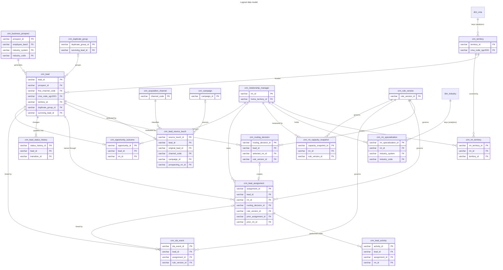

# CRM data model and dictionary

> **Hypothetical design for a fictional bank.** Everything in this document that describes a bank's internal CRM process, including current-state problems, SLAs, capacity limits, routing practices, specialist coverage and CRM behaviour, is a hypothetical current-state scenario, an illustrative control gap, a proposed target-state rule, a synthetic process assumption or a configurable business rule. None of it is a statement of fact about any real Canadian bank. The later CRM data will be entirely synthetic and will contain no real customer, employee, business, contact or banking information. All examples are fictional.

This is the logical data model for the hypothetical acquisition CRM described in
[crm_acquisition_process_and_requirements.md](crm_acquisition_process_and_requirements.md). It has **18** entities and
**239** fields, with **26** fields in the widest table (`crm_lead_assignment`). It is a contract for
future synthetic tables and dbt staging models; **no table, record or model exists yet**.

Design principles:

- Every table carries `created_at`, `updated_at` and `record_source` (always `synthetic_generator`).
- History is kept as rows: assignments, status changes, SLA events, routing decisions and capacity snapshots are never overwritten.
- Geography joins on `cma_code_sgc2021` (`analytics.dim_cma`) and industry on (`industry_system`, `industry_code`)
  (`analytics.dim_industry`). Names are never used as join keys.
- Contact fields are fictional only (reserved `.example` domains and 555-01xx numbers) and are excluded from analytical marts.
- No field stores an inferred language, identity or other personal characteristic; service language is stored only when stated.
- Every example value is fictional.

## Entity catalog

| ID | Table | Grain | Primary key | Record type | Fields | Future model |
|---|---|---|---|---|---|---|
| E-01 | crm_business_prospect | one row per synthetic business prospect | prospect_id | current-state | 13 | stg_crm__business_prospect |
| E-02 | crm_lead | one row per lead | lead_id | current-state (with derived current status) | 25 | stg_crm__lead |
| E-03 | crm_lead_source_touch | one row per lead source touch | source_touch_id | event history | 13 | stg_crm__lead_source_touch |
| E-04 | crm_acquisition_channel | one row per channel | channel_code | reference | 6 | stg_crm__acquisition_channel |
| E-05 | crm_campaign | one row per campaign | campaign_id | reference (effective-dated) | 9 | stg_crm__campaign |
| E-06 | crm_relationship_manager | one row per synthetic RM | rm_id | current-state (effective-dated employment) | 12 | stg_crm__relationship_manager |
| E-07 | crm_territory | one row per territory | territory_id | reference | 10 | stg_crm__territory |
| E-08 | crm_rm_territory | one row per RM x territory x effective period | rm_territory_id | effective-dated relationship | 9 | stg_crm__rm_territory |
| E-09 | crm_rm_specialization | one row per RM x industry x effective period | rm_specialization_id | effective-dated relationship | 10 | stg_crm__rm_specialization |
| E-10 | crm_rm_capacity_snapshot | one row per RM x snapshot date | capacity_snapshot_id | snapshot | 12 | stg_crm__rm_capacity_snapshot |
| E-11 | crm_routing_decision | one row per routing decision | routing_decision_id | event history | 21 | stg_crm__routing_decision |
| E-12 | crm_lead_assignment | one row per assignment | assignment_id | effective-dated relationship with status | 26 | stg_crm__lead_assignment |
| E-13 | crm_lead_activity | one row per activity | activity_id | event history | 12 | stg_crm__lead_activity |
| E-14 | crm_lead_status_history | one row per lead status change | status_history_id | event history | 13 | stg_crm__lead_status_history |
| E-15 | crm_sla_event | one row per SLA clock instance per lead or assignment | sla_event_id | event history | 16 | stg_crm__sla_event |
| E-16 | crm_duplicate_group | one row per duplicate group | duplicate_group_id | current-state | 11 | stg_crm__duplicate_group |
| E-17 | crm_opportunity_outcome | one row per opportunity (at most one per lead) | opportunity_id | current-state with outcome | 11 | stg_crm__opportunity_outcome |
| E-18 | crm_rule_version | one row per rule set x version | rule_version_id | reference (effective-dated) | 10 | stg_crm__rule_version |

## Field dictionary

Validation rules, field categories and foreign-key targets for each column are in `data/design/crm/crm_field_dictionary.csv`.

### E-01 `crm_business_prospect`

A synthetic business that may become a client; one business can generate several leads.

- **Grain:** one row per synthetic business prospect
- **Primary key:** `prospect_id`; **natural key:** synthetic_business_id
- **Foreign keys:** none
- **Record type:** current-state; **effective dates:** none; **retention:** Life of the synthetic dataset
- **Relationships:** 1 prospect : many leads
- **Future dbt model:** `stg_crm__business_prospect` (not built)

| Column | Type | Nullable | Accepted values | Description | Fictional example | Privacy |
|---|---|---|---|---|---|---|
| prospect_id | varchar | false |  | Surrogate key of the synthetic prospect. | PRS-000123 | synthetic identifier |
| synthetic_business_id | varchar | false |  | Synthetic business identifier used for exact duplicate matching (never a real business number). | SYN-BIZ-004521 | synthetic identifier |
| legal_name | varchar | false |  | Fictional legal business name. | Fictional Prospect 00123 Ltd. (fictional) | synthetic business attribute |
| normalized_legal_name | varchar | false |  | Legal name normalized for duplicate matching (case, punctuation, legal suffix removed). | fictional prospect 00123 | derived |
| operating_name | varchar | true |  | Fictional operating name if different. | Northwind Fictional Supply (fictional) | synthetic business attribute |
| employee_band | varchar | false | 1-4;5-19;20-99;100-499;500-plus;unknown | Employee-size band stated or estimated at capture. | 20-99 | business attribute |
| industry_system | varchar | true | NAICS2022_1097 | Industry classification system. | NAICS2022_1097 | business attribute |
| industry_code | varchar | true |  | Reviewed NAICS 2022 sector code from analytics.dim_industry. | 23 | business attribute |
| country_code | varchar | false | CA;other | Country of operation. | CA | business attribute |
| existing_relationship_flag | boolean | false | true;false | Prospect already holds a synthetic banking relationship (excluded from acquisition). | false | business attribute |
| created_at | timestamp | false |  | Time the record was created (UTC). | 2025-07-14T15:02:11Z | operational |
| updated_at | timestamp | true |  | Time the record was last updated (UTC); null for immutable event rows. | 2025-07-15T09:30:00Z | operational |
| record_source | varchar | false | synthetic_generator | System that produced the record; always the synthetic generator. | synthetic_generator | operational |

### E-02 `crm_lead`

An acquisition request for a prospect captured through a channel.

- **Grain:** one row per lead
- **Primary key:** `lead_id`; **natural key:** none
- **Foreign keys:** prospect_id -> crm_business_prospect; duplicate_group_id -> crm_duplicate_group; surviving_lead_id -> crm_lead; territory_id -> crm_territory; cma_code_sgc2021 -> analytics.dim_cma
- **Record type:** current-state (with derived current status); **effective dates:** none; **retention:** Life of the synthetic dataset
- **Relationships:** 1 lead : many source touches, assignments, activities, status rows, SLA events; 0..1 opportunity
- **Future dbt model:** `stg_crm__lead` (not built)

| Column | Type | Nullable | Accepted values | Description | Fictional example | Privacy |
|---|---|---|---|---|---|---|
| lead_id | varchar | false |  | Surrogate key of the lead. | LED-0004521 | synthetic identifier |
| prospect_id | varchar | false |  | Prospect the lead refers to. | PRS-000123 | synthetic identifier |
| captured_at | timestamp | false |  | Lead capture time (UTC). | 2025-07-14T15:02:11Z | operational |
| first_channel_code | varchar | false | CH-DIG;CH-BRN;CH-MKT;CH-PTR;CH-RMP | Channel of the first source touch. | CH-DIG | operational |
| contact_role | varchar | true | owner;finance lead;operations lead;other | Role of the (fictional) contact person; no name stored in analytical models. | owner | synthetic contact attribute |
| contact_email_fictional | varchar | true |  | Fictional contact email on a reserved .example domain; excluded from analytical marts. | contact@fictional-prospect-00123.example | synthetic contact (fictional) |
| contact_phone_fictional | varchar | true |  | Fictional phone number using exchange 555 with line 0100-0199 (reserved for fictional use); excluded from analytical marts. | +1-613-555-0123 | synthetic contact (fictional) |
| postal_fsa | varchar | true |  | Forward sortation area of the business location (geography, not an address). | T2P | business location (aggregate) |
| province_code | varchar | true | 10;11;12;13;24;35;46;47;48;59;60;61;62 | SGC province or territory code from the address. | 48 | business location (aggregate) |
| cma_code_sgc2021 | varchar | true |  | Resolved SGC 2021 CMA code; null outside the 41-CMA spine. | 825 | business location (aggregate) |
| territory_id | varchar | true |  | Resolved territory. | TER-CMA-825 | operational |
| geography_status | varchar | false | resolved_cma;resolved_province_remainder;missing;conflict;out_of_footprint | Outcome of geographic resolution. | resolved_cma | operational |
| market_evidence_flag | varchar | false | full_framework;scale_only_limited_evidence;no_market_context | Market-context availability for the lead's CMA. | full_framework | operational |
| stated_product_interest | varchar | true | operating account;credit;cash management;merchant services;not stated | Product interest stated at capture. | credit | business attribute |
| stated_service_language | varchar | true | en;fr;not stated | Service language explicitly stated by the prospect; never inferred. | not stated | stated preference |
| consent_to_contact_flag | boolean | false | true;false | Prospect consented to be contacted. | true | consent |
| priority_band | varchar | false | P1;P2;P3 | Priority band from a later model; default P2 until the model exists. | P2 | operational |
| current_lead_status | varchar | false | NEW;VALIDATION_PENDING;DUPLICATE_REVIEW;READY_FOR_ASSIGNMENT;ASSIGNED;CONTACTED;NURTURING;QUALIFIED;CONVERTED;CLOSED_LOST;INVALID;MERGED;WITHDRAWN | Current lead status, derived from the latest status-history row. | ASSIGNED | operational |
| disposition_code | varchar | true |  | Disposition for terminal leads. | DSP-NO-RESPONSE | operational |
| duplicate_group_id | varchar | true |  | Duplicate group, if any. | DUPG-000077 | synthetic identifier |
| surviving_lead_id | varchar | true |  | Survivor for MERGED leads. | LED-0004400 | synthetic identifier |
| synthetic_scenario_id | varchar | true |  | Synthetic scenario that generated this lead (for test traceability). | SC-01 | operational |
| created_at | timestamp | false |  | Time the record was created (UTC). | 2025-07-14T15:02:11Z | operational |
| updated_at | timestamp | true |  | Time the record was last updated (UTC); null for immutable event rows. | 2025-07-15T09:30:00Z | operational |
| record_source | varchar | false | synthetic_generator | System that produced the record; always the synthetic generator. | synthetic_generator | operational |

### E-03 `crm_lead_source_touch`

Every channel touch that created or re-created a lead, preserved through duplicate merges.

- **Grain:** one row per lead source touch
- **Primary key:** `source_touch_id`; **natural key:** none
- **Foreign keys:** lead_id -> crm_lead; original_lead_id -> crm_lead; channel_code -> crm_acquisition_channel; campaign_id -> crm_campaign
- **Record type:** event history; **effective dates:** none; **retention:** Life of the synthetic dataset
- **Relationships:** many touches : 1 lead (after merges)
- **Future dbt model:** `stg_crm__lead_source_touch` (not built)

| Column | Type | Nullable | Accepted values | Description | Fictional example | Privacy |
|---|---|---|---|---|---|---|
| source_touch_id | varchar | false |  | Surrogate key of the source touch. | TCH-0009012 | synthetic identifier |
| lead_id | varchar | false |  | Lead that currently holds the touch (the survivor after a merge). | LED-0004400 | synthetic identifier |
| original_lead_id | varchar | false |  | Lead originally created by the touch; never changed by merges. | LED-0004521 | synthetic identifier |
| channel_code | varchar | false | CH-DIG;CH-BRN;CH-MKT;CH-PTR;CH-RMP | Acquisition channel of the touch. | CH-MKT | operational |
| touched_at | timestamp | false |  | Time of the touch. | 2025-07-14T15:02:11Z | operational |
| campaign_id | varchar | true |  | Campaign for CH-MKT touches. | CMP-0012 | synthetic identifier |
| partner_code | varchar | true |  | Fictional partner code for CH-PTR touches. | PTN-FICT-031 | synthetic identifier |
| referring_branch_code | varchar | true |  | Fictional branch code for CH-BRN touches. | BRN-FICT-114 | synthetic identifier |
| prospecting_rm_id | varchar | true |  | Prospecting RM for CH-RMP touches. | RM-0042 | synthetic identifier |
| is_first_touch | boolean | false | true;false | First touch of the surviving lead (first-touch attribution). | true | derived |
| created_at | timestamp | false |  | Time the record was created (UTC). | 2025-07-14T15:02:11Z | operational |
| updated_at | timestamp | true |  | Time the record was last updated (UTC); null for immutable event rows. | 2025-07-15T09:30:00Z | operational |
| record_source | varchar | false | synthetic_generator | System that produced the record; always the synthetic generator. | synthetic_generator | operational |

### E-04 `crm_acquisition_channel`

Controlled channel catalog.

- **Grain:** one row per channel
- **Primary key:** `channel_code`; **natural key:** none
- **Foreign keys:** none
- **Record type:** reference; **effective dates:** none; **retention:** Permanent
- **Relationships:** 1 channel : many source touches
- **Future dbt model:** `stg_crm__acquisition_channel` (not built)

| Column | Type | Nullable | Accepted values | Description | Fictional example | Privacy |
|---|---|---|---|---|---|---|
| channel_code | varchar | false | CH-DIG;CH-BRN;CH-MKT;CH-PTR;CH-RMP | Channel code from the acquisition channel catalog. | CH-BRN | reference |
| channel_name | varchar | false |  | Business name of the channel. | Branch referral | reference |
| default_assignment_sla_id | varchar | false | SLA-04A;SLA-04B;SLA-04C | Assignment SLA applied to the channel. | SLA-04B | reference |
| created_at | timestamp | false |  | Time the record was created (UTC). | 2025-07-14T15:02:11Z | operational |
| updated_at | timestamp | true |  | Time the record was last updated (UTC); null for immutable event rows. | 2025-07-15T09:30:00Z | operational |
| record_source | varchar | false | synthetic_generator | System that produced the record; always the synthetic generator. | synthetic_generator | operational |

### E-05 `crm_campaign`

Synthetic marketing campaigns used for attribution.

- **Grain:** one row per campaign
- **Primary key:** `campaign_id`; **natural key:** campaign_code
- **Foreign keys:** none
- **Record type:** reference (effective-dated); **effective dates:** campaign_start_date to campaign_end_date; **retention:** Life of the synthetic dataset
- **Relationships:** 1 campaign : many source touches
- **Future dbt model:** `stg_crm__campaign` (not built)

| Column | Type | Nullable | Accepted values | Description | Fictional example | Privacy |
|---|---|---|---|---|---|---|
| campaign_id | varchar | false |  | Surrogate key. | CMP-0012 | synthetic identifier |
| campaign_code | varchar | false |  | Fictional campaign code. | CMP-FICT-2025-Q3-07 | synthetic identifier |
| campaign_name | varchar | false |  | Fictional campaign name. | Fictional autumn cash-flow webinar | synthetic attribute |
| target_segment | varchar | true | micro;established;all | Target SME segment. | established | operational |
| campaign_start_date | date | false |  | Start date. | 2025-09-01 | operational |
| campaign_end_date | date | false |  | End date. | 2025-10-15 | operational |
| created_at | timestamp | false |  | Time the record was created (UTC). | 2025-07-14T15:02:11Z | operational |
| updated_at | timestamp | true |  | Time the record was last updated (UTC); null for immutable event rows. | 2025-07-15T09:30:00Z | operational |
| record_source | varchar | false | synthetic_generator | System that produced the record; always the synthetic generator. | synthetic_generator | operational |

### E-06 `crm_relationship_manager`

Synthetic relationship managers who own leads.

- **Grain:** one row per synthetic RM
- **Primary key:** `rm_id`; **natural key:** rm_code
- **Foreign keys:** home_territory_id -> crm_territory
- **Record type:** current-state (effective-dated employment); **effective dates:** employment_start_date to employment_end_date; **retention:** Life of the synthetic dataset
- **Relationships:** 1 RM : many assignments, territories, specializations, capacity snapshots
- **Future dbt model:** `stg_crm__relationship_manager` (not built)

| Column | Type | Nullable | Accepted values | Description | Fictional example | Privacy |
|---|---|---|---|---|---|---|
| rm_id | varchar | false |  | Surrogate key of the synthetic RM (no real employee). | RM-0042 | synthetic identifier |
| rm_code | varchar | false |  | Fictional RM code; no names are stored. | RM-FICT-0042 | synthetic identifier |
| rm_segment | varchar | false | small_business;commercial | Segment the RM serves. | commercial | operational |
| home_territory_id | varchar | false |  | Primary territory. | TER-CMA-825 | operational |
| supported_service_languages | varchar | false | en;fr;en\|fr | Service languages the RM supports (for explicitly stated preferences only). | en\|fr | operational |
| base_capacity_points | decimal(6,2) | false |  | Base weighted capacity (CAP-05; configurable). | 40.00 | operational |
| employment_start_date | date | false |  | Synthetic start date. | 2021-03-01 | operational |
| employment_end_date | date | true |  | Synthetic end date; null if active. | 2026-03-31 (null while employed) | operational |
| active_flag | boolean | false | true;false | Currently active. | true | operational |
| created_at | timestamp | false |  | Time the record was created (UTC). | 2025-07-14T15:02:11Z | operational |
| updated_at | timestamp | true |  | Time the record was last updated (UTC); null for immutable event rows. | 2025-07-15T09:30:00Z | operational |
| record_source | varchar | false | synthetic_generator | System that produced the record; always the synthetic generator. | synthetic_generator | operational |

### E-07 `crm_territory`

Hypothetical territory definitions keyed on SGC 2021 geography.

- **Grain:** one row per territory
- **Primary key:** `territory_id`; **natural key:** territory_code
- **Foreign keys:** cma_code_sgc2021 -> analytics.dim_cma
- **Record type:** reference; **effective dates:** none; **retention:** Permanent
- **Relationships:** 1 territory : many RM territories and leads
- **Future dbt model:** `stg_crm__territory` (not built)

| Column | Type | Nullable | Accepted values | Description | Fictional example | Privacy |
|---|---|---|---|---|---|---|
| territory_id | varchar | false |  | Surrogate key. | TER-CMA-825 | reference |
| territory_code | varchar | false |  | Business code. | CMA-825 | reference |
| territory_type | varchar | false | cma;province_remainder;remote_service;national_specialist | Territory type (TER rules). | cma | reference |
| cma_code_sgc2021 | varchar | true |  | SGC 2021 CMA code for cma territories. | 825 | reference |
| province_code | varchar | true |  | Province code for province_remainder territories. | 48 | reference |
| sales_region | varchar | false | Atlantic;Quebec;Ontario;Prairies;British Columbia and North;National | Hypothetical sales region grouping. | Prairies | reference |
| evidence_tier | integer | true | 1;2;3 | Evidence tier of the CMA (from analytics.dim_cma). | 1 | reference |
| created_at | timestamp | false |  | Time the record was created (UTC). | 2025-07-14T15:02:11Z | operational |
| updated_at | timestamp | true |  | Time the record was last updated (UTC); null for immutable event rows. | 2025-07-15T09:30:00Z | operational |
| record_source | varchar | false | synthetic_generator | System that produced the record; always the synthetic generator. | synthetic_generator | operational |

### E-08 `crm_rm_territory`

Which RM covers which territory, and when.

- **Grain:** one row per RM x territory x effective period
- **Primary key:** `rm_territory_id`; **natural key:** rm_id + territory_id + valid_from
- **Foreign keys:** rm_id -> crm_relationship_manager; territory_id -> crm_territory
- **Record type:** effective-dated relationship; **effective dates:** valid_from to valid_to; **retention:** Life of the synthetic dataset
- **Relationships:** many : many between RMs and territories
- **Future dbt model:** `stg_crm__rm_territory` (not built)

| Column | Type | Nullable | Accepted values | Description | Fictional example | Privacy |
|---|---|---|---|---|---|---|
| rm_territory_id | varchar | false |  | Surrogate key. | RMT-000311 | synthetic identifier |
| rm_id | varchar | false |  | RM. | RM-0042 | synthetic identifier |
| territory_id | varchar | false |  | Territory covered. | TER-CMA-825 | reference |
| coverage_role | varchar | false | primary;backup | Coverage role. | primary | operational |
| valid_from | date | false |  | Coverage start. | 2025-06-01 | operational |
| valid_to | date | true |  | Coverage end; null if open. | 2025-12-31 (null while current) | operational |
| created_at | timestamp | false |  | Time the record was created (UTC). | 2025-07-14T15:02:11Z | operational |
| updated_at | timestamp | true |  | Time the record was last updated (UTC); null for immutable event rows. | 2025-07-15T09:30:00Z | operational |
| record_source | varchar | false | synthetic_generator | System that produced the record; always the synthetic generator. | synthetic_generator | operational |

### E-09 `crm_rm_specialization`

Industry specializations held by RMs, keyed on reviewed industry codes.

- **Grain:** one row per RM x industry x effective period
- **Primary key:** `rm_specialization_id`; **natural key:** rm_id + industry_code + valid_from
- **Foreign keys:** rm_id -> crm_relationship_manager; (industry_system, industry_code) -> analytics.dim_industry
- **Record type:** effective-dated relationship; **effective dates:** valid_from to valid_to; **retention:** Life of the synthetic dataset
- **Relationships:** many : many between RMs and industries
- **Future dbt model:** `stg_crm__rm_specialization` (not built)

| Column | Type | Nullable | Accepted values | Description | Fictional example | Privacy |
|---|---|---|---|---|---|---|
| rm_specialization_id | varchar | false |  | Surrogate key. | RMS-000088 | synthetic identifier |
| rm_id | varchar | false |  | RM. | RM-0042 | synthetic identifier |
| industry_system | varchar | false | NAICS2022_1097 | Industry system. | NAICS2022_1097 | reference |
| industry_code | varchar | false |  | Reviewed NAICS 2022 sector code (SPC catalog). | 11 | reference |
| specialist_type | varchar | false |  | Specialist type from the specialist rule catalog. | agriculture specialist | operational |
| valid_from | date | false |  | Start. | 2025-06-01 | operational |
| valid_to | date | true |  | End; null if open. | 2026-02-28 (null while current) | operational |
| created_at | timestamp | false |  | Time the record was created (UTC). | 2025-07-14T15:02:11Z | operational |
| updated_at | timestamp | true |  | Time the record was last updated (UTC); null for immutable event rows. | 2025-07-15T09:30:00Z | operational |
| record_source | varchar | false | synthetic_generator | System that produced the record; always the synthetic generator. | synthetic_generator | operational |

### E-10 `crm_rm_capacity_snapshot`

Daily RM availability and weighted workload.

- **Grain:** one row per RM x snapshot date
- **Primary key:** `capacity_snapshot_id`; **natural key:** rm_id + snapshot_date
- **Foreign keys:** rm_id -> crm_relationship_manager; rule_version_id -> crm_rule_version
- **Record type:** snapshot; **effective dates:** snapshot_date; **retention:** Life of the synthetic dataset
- **Relationships:** many snapshots : 1 RM
- **Future dbt model:** `stg_crm__rm_capacity_snapshot` (not built)

| Column | Type | Nullable | Accepted values | Description | Fictional example | Privacy |
|---|---|---|---|---|---|---|
| capacity_snapshot_id | varchar | false |  | Surrogate key. | CAPS-0120044 | synthetic identifier |
| rm_id | varchar | false |  | RM. | RM-0042 | synthetic identifier |
| snapshot_date | date | false |  | Business date of the snapshot. | 2025-10-06 | operational |
| availability_status | varchar | false | available;partial;planned_leave;unavailable | Availability on the date. | available | operational |
| available_capacity_points | decimal(6,2) | false |  | Capacity after availability pro-rating (CAP-08). | 40.00 | operational |
| weighted_workload_points | decimal(6,2) | false |  | Weighted workload (CAP-01..CAP-04). | 31.50 | operational |
| utilization_ratio | decimal(6,4) | true |  | Workload / available capacity; null when capacity is 0. | 0.7875 | operational |
| capacity_state | varchar | false | below_warning;warning;at_or_above_hard_limit;approved_exception;unavailable | State against CAP-06/CAP-09. | below_warning | operational |
| rule_version_id | varchar | false |  | Capacity rule version applied. | RV-CAPACITY-001 | reference |
| created_at | timestamp | false |  | Time the record was created (UTC). | 2025-07-14T15:02:11Z | operational |
| updated_at | timestamp | true |  | Time the record was last updated (UTC); null for immutable event rows. | 2025-07-15T09:30:00Z | operational |
| record_source | varchar | false | synthetic_generator | System that produced the record; always the synthetic generator. | synthetic_generator | operational |

### E-11 `crm_routing_decision`

Every routing evaluation with inputs, rule version and outcome.

- **Grain:** one row per routing decision
- **Primary key:** `routing_decision_id`; **natural key:** none
- **Foreign keys:** lead_id -> crm_lead; selected_rm_id -> crm_relationship_manager; rule_version_id -> crm_rule_version
- **Record type:** event history; **effective dates:** decided_at; **retention:** Life of the synthetic dataset
- **Relationships:** many decisions : 1 lead; 1 decision : 0..1 assignment
- **Future dbt model:** `stg_crm__routing_decision` (not built)

| Column | Type | Nullable | Accepted values | Description | Fictional example | Privacy |
|---|---|---|---|---|---|---|
| routing_decision_id | varchar | false |  | Surrogate key. | RTD-0007710 | synthetic identifier |
| lead_id | varchar | false |  | Lead routed. | LED-0004521 | synthetic identifier |
| decided_at | timestamp | false |  | Decision time. | 2025-07-14T15:40:00Z | operational |
| lead_status_at_decision | varchar | false | READY_FOR_ASSIGNMENT | Lead status when decided (RT-E04). | READY_FOR_ASSIGNMENT | operational |
| routing_outcome | varchar | false | assigned_rm;queued_regional;queued_national;queued_specialist;queued_manual_review;self_assigned;override_assigned | Outcome. | assigned_rm | operational |
| selected_rm_id | varchar | true |  | Selected RM; null for queue outcomes. | RM-0042 | synthetic identifier |
| candidate_count | integer | false |  | Eligible candidates after exclusions. | 4 | operational |
| excluded_rm_count | integer | false |  | RMs excluded by RT-X rules. | 2 | operational |
| territory_match_flag | boolean | true | true;false | Selected RM covers the lead territory. | true | operational |
| segment_match_flag | boolean | true | true;false | Segment matched (RT-P02). | true | operational |
| specialist_match_flag | boolean | true | true;false | Specialist matched when required or preferred. | true | operational |
| language_match_flag | boolean | true | true;false | Stated language matched; null when not stated. | true (null when no language stated) | operational |
| capacity_utilization_at_decision | decimal(6,4) | true |  | Selected RM's utilization at decision time. | 0.7875 | operational |
| tie_break_applied_flag | boolean | false | true;false | Tie-breaking rule used (RT-L02). | false | operational |
| rule_trace | varchar | false |  | Ordered rule IDs evaluated, with outcome codes. | RT-E01:pass\|RT-E02:pass\|...\|RT-L01:selected | operational |
| manual_review_reason | varchar | true | geography_conflict;missing_geography;conflict_of_interest;other | Reason for manual review. | geography_conflict | operational |
| market_scenario_id | varchar | true | balanced;scale_led;growth_led;stability_aware | Market-opportunity scenario used as context. | balanced | operational |
| rule_version_id | varchar | false |  | Routing rule version. | RV-ROUTING-001 | reference |
| created_at | timestamp | false |  | Time the record was created (UTC). | 2025-07-14T15:02:11Z | operational |
| updated_at | timestamp | true |  | Time the record was last updated (UTC); null for immutable event rows. | 2025-07-15T09:30:00Z | operational |
| record_source | varchar | false | synthetic_generator | System that produced the record; always the synthetic generator. | synthetic_generator | operational |

### E-12 `crm_lead_assignment`

Ownership of a lead by an RM or queue over time.

- **Grain:** one row per assignment
- **Primary key:** `assignment_id`; **natural key:** none
- **Foreign keys:** lead_id -> crm_lead; rm_id -> crm_relationship_manager; routing_decision_id -> crm_routing_decision; prior_assignment_id -> crm_lead_assignment; rule_version_id -> crm_rule_version
- **Record type:** effective-dated relationship with status; **effective dates:** assigned_at to ended_at; **retention:** Life of the synthetic dataset
- **Relationships:** many assignments : 1 lead (one active primary)
- **Future dbt model:** `stg_crm__lead_assignment` (not built)

| Column | Type | Nullable | Accepted values | Description | Fictional example | Privacy |
|---|---|---|---|---|---|---|
| assignment_id | varchar | false |  | Surrogate key. | ASG-0006120 | synthetic identifier |
| lead_id | varchar | false |  | Lead. | LED-0004521 | synthetic identifier |
| rm_id | varchar | true |  | Assigned RM; null for QUEUED assignments. | RM-0042 | synthetic identifier |
| queue_code | varchar | true | regional;national;specialist;manual_review | Queue for QUEUED assignments. | Q-REGIONAL-ON | operational |
| assignment_role | varchar | false | primary;specialist_support | Primary owner or specialist support. | primary | operational |
| assignment_status | varchar | false | QUEUED;ASSIGNED;ACKNOWLEDGED;DECLINED;REASSIGNMENT_PENDING;REASSIGNED;COMPLETED;CANCELLED | Assignment status. | ACKNOWLEDGED | operational |
| active_flag | boolean | false | true;false | Assignment active (QUEUED, ASSIGNED, ACKNOWLEDGED or REASSIGNMENT_PENDING). | true | derived |
| assigned_at | timestamp | false |  | Assignment (or queue) time. | 2025-07-14T15:41:00Z | operational |
| assignment_reason | varchar | false | routing_rule;self_assignment;reassignment;override;queue_fallback | Why the assignment exists. | routing_rule | operational |
| routing_decision_id | varchar | true |  | Routing decision that produced it. | RTD-0007710 | synthetic identifier |
| rule_version_id | varchar | false |  | Rule version used. | RV-ROUTING-001 | reference |
| prior_assignment_id | varchar | true |  | Assignment it replaced (reassignment). | ASG-0006001 | synthetic identifier |
| prior_rm_id | varchar | true |  | Previous owner, when reassigned. | RM-0017 | synthetic identifier |
| acknowledged_at | timestamp | true |  | Acknowledgement time. | 2025-07-14T17:05:00Z | operational |
| declined_at | timestamp | true |  | Decline time. | 2025-07-14T16:10:00Z | operational |
| decline_reason | varchar | true | capacity;conflict;wrong_territory;wrong_segment;other | Decline reason. | conflict_of_interest | operational |
| reassignment_triggered_at | timestamp | true |  | When a reassignment condition occurred. | 2025-07-15T13:00:00Z | operational |
| reassignment_reason | varchar | true | acknowledgement_breach;first_contact_breach;inactivity;rm_unavailable;decline;manager_decision | Why reassignment happened. | acknowledgement_sla_breach | operational |
| ended_at | timestamp | true |  | End time for ended assignments. | 2025-07-15T14:05:00Z | operational |
| manual_override_flag | boolean | false | true;false | Created or ended by a manager override (RT-O01). | false | operational |
| override_reason_code | varchar | true | client_relationship;specialist_need;capacity_rebalancing;territory_correction;other | Override reason. | client_relationship_continuity | operational |
| override_user_role | varchar | true | Regional Sales Manager;Director, Business Banking Sales Strategy | Role that applied the override. | Regional Sales Manager | operational |
| capacity_exception_flag | boolean | false | true;false | Assignment made above the hard limit under CAP-09. | false | operational |
| created_at | timestamp | false |  | Time the record was created (UTC). | 2025-07-14T15:02:11Z | operational |
| updated_at | timestamp | true |  | Time the record was last updated (UTC); null for immutable event rows. | 2025-07-15T09:30:00Z | operational |
| record_source | varchar | false | synthetic_generator | System that produced the record; always the synthetic generator. | synthetic_generator | operational |

### E-13 `crm_lead_activity`

Contact attempts, conversations, meetings and nurture tasks.

- **Grain:** one row per activity
- **Primary key:** `activity_id`; **natural key:** none
- **Foreign keys:** lead_id -> crm_lead; rm_id -> crm_relationship_manager; assignment_id -> crm_lead_assignment
- **Record type:** event history; **effective dates:** activity_at; **retention:** Life of the synthetic dataset
- **Relationships:** many activities : 1 lead
- **Future dbt model:** `stg_crm__lead_activity` (not built)

| Column | Type | Nullable | Accepted values | Description | Fictional example | Privacy |
|---|---|---|---|---|---|---|
| activity_id | varchar | false |  | Surrogate key. | ACT-0031004 | synthetic identifier |
| lead_id | varchar | false |  | Lead. | LED-0004521 | synthetic identifier |
| assignment_id | varchar | false |  | Assignment under which the activity happened. | ASG-0006120 | synthetic identifier |
| rm_id | varchar | false |  | RM who performed it. | RM-0042 | synthetic identifier |
| activity_at | timestamp | false |  | Time of the activity. | 2025-07-15T14:00:00Z | operational |
| activity_type | varchar | false | call_attempt;email_attempt;conversation;meeting;nurture_task;note | Activity type. | call_attempt | operational |
| activity_outcome | varchar | false | no_answer;left_message;two_way_contact;meeting_held;scheduled;completed | Outcome. | no_answer | operational |
| counts_as_contact_attempt | boolean | false | true;false | Counts toward first-contact and attempt limits. | true | derived |
| next_contact_due_at | timestamp | true |  | Next scheduled contact (nurturing). | 2025-09-15 | operational |
| created_at | timestamp | false |  | Time the record was created (UTC). | 2025-07-14T15:02:11Z | operational |
| updated_at | timestamp | true |  | Time the record was last updated (UTC); null for immutable event rows. | 2025-07-15T09:30:00Z | operational |
| record_source | varchar | false | synthetic_generator | System that produced the record; always the synthetic generator. | synthetic_generator | operational |

### E-14 `crm_lead_status_history`

Every lead status change with its transition and event.

- **Grain:** one row per lead status change
- **Primary key:** `status_history_id`; **natural key:** none
- **Foreign keys:** lead_id -> crm_lead; transition_id -> lead_transition_rules
- **Record type:** event history; **effective dates:** changed_at; **retention:** Life of the synthetic dataset
- **Relationships:** many changes : 1 lead
- **Future dbt model:** `stg_crm__lead_status_history` (not built)

| Column | Type | Nullable | Accepted values | Description | Fictional example | Privacy |
|---|---|---|---|---|---|---|
| status_history_id | varchar | false |  | Surrogate key. | LSH-0019002 | synthetic identifier |
| lead_id | varchar | false |  | Lead. | LED-0004521 | synthetic identifier |
| from_status | varchar | true | NEW;VALIDATION_PENDING;DUPLICATE_REVIEW;READY_FOR_ASSIGNMENT;ASSIGNED;CONTACTED;NURTURING;QUALIFIED;CONVERTED;CLOSED_LOST;INVALID;MERGED;WITHDRAWN | Previous status; null for the first row (NEW). | READY_FOR_ASSIGNMENT | operational |
| to_status | varchar | false | NEW;VALIDATION_PENDING;DUPLICATE_REVIEW;READY_FOR_ASSIGNMENT;ASSIGNED;CONTACTED;NURTURING;QUALIFIED;CONVERTED;CLOSED_LOST;INVALID;MERGED;WITHDRAWN | New status. | ASSIGNED | operational |
| transition_id | varchar | true |  | Transition rule applied; null for the first row. | T-12 | reference |
| event_code | varchar | false |  | Triggering event. | ASSIGNMENT_CREATED | reference |
| changed_at | timestamp | false |  | Time of the change. | 2025-07-14T15:41:00Z | operational |
| disposition_code | varchar | true |  | Disposition when to_status is terminal. | DSP-NO-RESPONSE | operational |
| actor_role | varchar | false |  | Role or system that made the change. | Routing service | operational |
| reopen_approver_role | varchar | true | Regional Sales Manager;Director, Business Banking Sales Strategy | Approver for audited reopenings. | Regional Sales Manager | operational |
| created_at | timestamp | false |  | Time the record was created (UTC). | 2025-07-14T15:02:11Z | operational |
| updated_at | timestamp | true |  | Time the record was last updated (UTC); null for immutable event rows. | 2025-07-15T09:30:00Z | operational |
| record_source | varchar | false | synthetic_generator | System that produced the record; always the synthetic generator. | synthetic_generator | operational |

### E-15 `crm_sla_event`

SLA clocks and their warning, breach, met and escalation events.

- **Grain:** one row per SLA clock instance per lead or assignment
- **Primary key:** `sla_event_id`; **natural key:** none
- **Foreign keys:** lead_id -> crm_lead; assignment_id -> crm_lead_assignment; rule_version_id -> crm_rule_version
- **Record type:** event history; **effective dates:** started_at to stopped_at; **retention:** Life of the synthetic dataset
- **Relationships:** many SLA events : 1 lead
- **Future dbt model:** `stg_crm__sla_event` (not built)

| Column | Type | Nullable | Accepted values | Description | Fictional example | Privacy |
|---|---|---|---|---|---|---|
| sla_event_id | varchar | false |  | Surrogate key. | SLE-0040011 | synthetic identifier |
| lead_id | varchar | false |  | Lead. | LED-0004521 | synthetic identifier |
| assignment_id | varchar | true |  | Assignment, for RM SLAs. | ASG-0006120 | synthetic identifier |
| sla_id | varchar | false |  | SLA rule from the SLA catalog. | SLA-06B | reference |
| started_at | timestamp | false |  | Clock start (start event time). | 2025-07-14T15:41:00Z | operational |
| target_at | timestamp | false |  | Breach time computed on the SLA's time basis. | 2025-07-16T15:41:00Z | derived |
| warning_at | timestamp | false |  | Warning time. | 2025-07-15T15:41:00Z | derived |
| stopped_at | timestamp | true |  | Clock stop (stop event time); null while open. | 2025-07-15T14:00:00Z | operational |
| stop_event_code | varchar | true |  | Event that stopped the clock. | CONTACT_ATTEMPTED | reference |
| sla_outcome | varchar | false | open;met;warning_open;breached_open;breached_closed;not_applicable | Outcome. | met | derived |
| paused_minutes | integer | false |  | Business minutes paused under the SLA's pause conditions. | 0 | operational |
| escalation_level | integer | false | 0;1;2 | Highest escalation reached. | 0 | operational |
| rule_version_id | varchar | false |  | SLA rule version. | RV-SLA-001 | reference |
| created_at | timestamp | false |  | Time the record was created (UTC). | 2025-07-14T15:02:11Z | operational |
| updated_at | timestamp | true |  | Time the record was last updated (UTC); null for immutable event rows. | 2025-07-15T09:30:00Z | operational |
| record_source | varchar | false | synthetic_generator | System that produced the record; always the synthetic generator. | synthetic_generator | operational |

### E-16 `crm_duplicate_group`

A set of leads judged to be the same business, with the survivor.

- **Grain:** one row per duplicate group
- **Primary key:** `duplicate_group_id`; **natural key:** none
- **Foreign keys:** surviving_lead_id -> crm_lead
- **Record type:** current-state; **effective dates:** resolved_at; **retention:** Life of the synthetic dataset
- **Relationships:** 1 group : 2+ leads
- **Future dbt model:** `stg_crm__duplicate_group` (not built)

| Column | Type | Nullable | Accepted values | Description | Fictional example | Privacy |
|---|---|---|---|---|---|---|
| duplicate_group_id | varchar | false |  | Surrogate key. | DUPG-000077 | synthetic identifier |
| match_rule_id | varchar | false |  | Duplicate rule that matched. | DUP-03 | reference |
| match_tier | varchar | false | exact;high_confidence;review | Tier. | high_confidence | reference |
| review_decision | varchar | true | confirmed;rejected | Human decision for review-tier groups. | confirmed_duplicate | operational |
| surviving_lead_id | varchar | true |  | Surviving lead (DUP-07). | LED-0004400 | synthetic identifier |
| member_count | integer | false |  | Leads in the group. | 2 | derived |
| flagged_at | timestamp | false |  | Time the match was flagged. | 2025-07-14T15:10:00Z | operational |
| resolved_at | timestamp | true |  | Time resolved. | 2025-07-15T10:00:00Z | operational |
| created_at | timestamp | false |  | Time the record was created (UTC). | 2025-07-14T15:02:11Z | operational |
| updated_at | timestamp | true |  | Time the record was last updated (UTC); null for immutable event rows. | 2025-07-15T09:30:00Z | operational |
| record_source | varchar | false | synthetic_generator | System that produced the record; always the synthetic generator. | synthetic_generator | operational |

### E-17 `crm_opportunity_outcome`

The qualified pursuit opened from a lead and its outcome.

- **Grain:** one row per opportunity (at most one per lead)
- **Primary key:** `opportunity_id`; **natural key:** lead_id
- **Foreign keys:** lead_id -> crm_lead; rm_id -> crm_relationship_manager
- **Record type:** current-state with outcome; **effective dates:** opened_at to closed_at; **retention:** Life of the synthetic dataset
- **Relationships:** 0..1 opportunity : 1 lead
- **Future dbt model:** `stg_crm__opportunity_outcome` (not built)

| Column | Type | Nullable | Accepted values | Description | Fictional example | Privacy |
|---|---|---|---|---|---|---|
| opportunity_id | varchar | false |  | Surrogate key. | OPP-0001203 | synthetic identifier |
| lead_id | varchar | false |  | Qualified lead (one opportunity per lead). | LED-0004521 | synthetic identifier |
| rm_id | varchar | false |  | Owning RM. | RM-0042 | synthetic identifier |
| opened_at | timestamp | false |  | Opened at qualification. | 2025-08-02T16:00:00Z | operational |
| opportunity_status | varchar | false | open;won;lost;withdrawn | Opportunity status (separate from lead status). | won | operational |
| primary_product | varchar | true | operating account;credit;cash management;merchant services | Main product pursued. | credit | business attribute |
| closed_at | timestamp | true |  | Outcome time. | 2025-09-12T13:00:00Z | operational |
| outcome_reason | varchar | true |  | Disposition code for lost or withdrawn outcomes. | DSP-WON | operational |
| created_at | timestamp | false |  | Time the record was created (UTC). | 2025-07-14T15:02:11Z | operational |
| updated_at | timestamp | true |  | Time the record was last updated (UTC); null for immutable event rows. | 2025-07-15T09:30:00Z | operational |
| record_source | varchar | false | synthetic_generator | System that produced the record; always the synthetic generator. | synthetic_generator | operational |

### E-18 `crm_rule_version`

Versioned configuration of routing, SLA, capacity and duplicate rules.

- **Grain:** one row per rule set x version
- **Primary key:** `rule_version_id`; **natural key:** rule_set + version_number
- **Foreign keys:** none
- **Record type:** reference (effective-dated); **effective dates:** effective_from to effective_to; **retention:** Permanent
- **Relationships:** 1 version : many decisions, assignments, SLA events, snapshots
- **Future dbt model:** `stg_crm__rule_version` (not built)

| Column | Type | Nullable | Accepted values | Description | Fictional example | Privacy |
|---|---|---|---|---|---|---|
| rule_version_id | varchar | false |  | Surrogate key. | RV-ROUTING-001 | reference |
| rule_set | varchar | false | routing;sla;capacity;duplicate;territory;specialist | Rule set. | routing | reference |
| version_number | integer | false |  | Version within the rule set. | 1 | reference |
| effective_from | timestamp | false |  | Start of validity. | 2025-06-01T00:00:00Z | reference |
| effective_to | timestamp | true |  | End of validity; null if current. | 2025-11-30 (null while current) | reference |
| config_sha256 | varchar | false |  | Hash of the rule catalog content used. | 3f5a...(64 hex) | reference |
| approved_by_role | varchar | false | Director, Business Banking Sales Strategy | Approving role. | Director, Business Banking Sales Strategy | reference |
| created_at | timestamp | false |  | Time the record was created (UTC). | 2025-07-14T15:02:11Z | operational |
| updated_at | timestamp | true |  | Time the record was last updated (UTC); null for immutable event rows. | 2025-07-15T09:30:00Z | operational |
| record_source | varchar | false | synthetic_generator | System that produced the record; always the synthetic generator. | synthetic_generator | operational |
