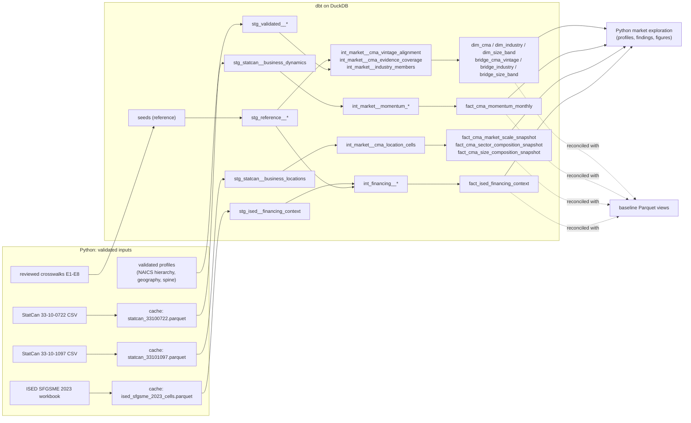

# dbt Transformation Layer

**Canadian SME Acquisition Strategy.** This document describes the analytical data platform's transformation layer:
- **dbt** owns the transformation logic;
- **DuckDB** is the local analytical warehouse;
- **Python** keeps source validation, statistical exploration and charts.

It covers:
- the division of responsibilities;
- source-to-mart lineage;
- each model layer;
- the grain of every final model;
- the tests;
- the reconciliation that proves the dbt marts reproduce the validated analytical views.

The business rules are unchanged. They are documented in [03_mvp_analytical_scope.md](03_mvp_analytical_scope.md) and [04_analytical_data_layer.md](04_analytical_data_layer.md).

**Important framing**
- Everything here is **public aggregate data**. No row is an individual business, prospect or lead.
- The internal CRM data introduced later in the project will be **synthetic**. Hypothetical internal-process problems are illustrations, not claims about any real Canadian bank.
- ISED financing estimates are **contextual evidence**, not market-size inputs.
- **Tier 3 CMAs** (six markets that were census agglomerations in 2016) have scale and composition data only. They are not eligible for momentum-based comparison.

---

## 1. Responsibilities

| Component | Owns |
|---|---|
| **Python** (Anaconda environment) | Source download and extraction; raw-file validation; cache creation and lineage validation; ISED workbook parsing; source-specific structural validation; crosswalk validation; later synthetic CRM generation; statistical exploration; charts; exports and reconciliation utilities |
| **dbt** (isolated `.venv`) | Source declarations; typing and standardization; relational transformations; reusable business logic; grain enforcement; crosswalk joins; dimensions, bridges and facts; data-quality tests; model and column documentation; source-to-mart lineage; the authoritative analytical relations used downstream |
| **DuckDB** | The local warehouse `data/warehouse/sme_banking.duckdb`, which holds every dbt-built schema and relation |

- **The Python analytical-layer script stays.** `src/analytics/09_build_analytical_views.py` and its Parquet output (`data/processed/analytical_views/`) are kept unchanged as the reconciliation baseline.
- **Market exploration now reads the dbt marts.** `src/analysis/10_explore_market_opportunity.py` reads the marts instead of the Parquet views.

## 2. Warehouse schemas

| Schema | Built by | Contents |
|---|---|---|
| `reference` | `dbt seed` | 10 reviewed crosswalks (read in place from `data/reference/crosswalks/`) and 8 reviewed code maps (`seeds/`) |
| `staging` | staging models (views) | Typed, renamed source relations and validated profiles |
| `intermediate` | intermediate models (tables) | Reusable business logic, one grain per model |
| `analytics` | marts (tables) | The 11 authoritative analytical relations |

The `generate_schema_name` macro keeps these names exactly as written, without the target-name prefix dbt normally adds.

## 3. Lineage



## 4. Sources

Sources are declared in `models/sources/_sources.yml` and read in place with dbt-duckdb's `external_location`, using `read_parquet` or `read_csv(all_varchar=true)`. Nothing is copied.

| Source | Relation | Grain | Unit | Coverage |
|---|---|---|---|---|
| `statcan_cache.business_dynamics` | `data/cache/statcan_33100722.parquet` (8,575,672 rows) | geography × industry × size × measure × month | enterprise | 2015-01 to 2026-05, monthly, seasonally adjusted; Canada, provinces, territories, 35 CMAs (SGC 2016) |
| `statcan_cache.business_locations` | `data/cache/statcan_33101097.parquet` (1,050,274 rows) | geography × size × NAICS member | employer location | December 2025 (REF_DATE 2025-07); 41 CMAs and CSDs (SGC 2021) |
| `ised_cache.financing_cells` | `data/cache/ised_sfgsme_2023_cells.parquet` (79,876 cells) | table × measure × stub row | survey estimate | calendar 2023; national, regions, 24 CMA labels |
| `validated_profiles.*` | six CSVs in `data/validation/` | per member or geography | classification | NAICS hierarchy, geography, size totals, 0722 members, ISED definitions, approved spine |

**Lineage of the StatCan caches.** Each carries a `.lineage.json` record, `src/validation/verify_pipeline_inputs.py` re-checks it before every build, and a stale cache stops the pipeline. The record holds:
- the source checksum, matched against `data/source_manifest.csv`;
- the schema version;
- the cache checksum;
- a row-parity digest.

**Missing values** in all sources:
- StatCan `x` (suppressed) and `..` (not available) stay NULL, never zero.
- `E` is carried as a caution flag.
- ISED `..` and blank cells stay NULL.
- A 1097 cell omitted inside a listed CMA counts as zero, because the validation evidence proves it by reconciliation. Each fact row counts how many such cells it includes.

## 5. Seeds: reviewed crosswalks and code maps

- **Crosswalks.** `seed-paths` includes `data/reference/crosswalks`, so the reviewed files are loaded where they are. There is **one authoritative copy**.
- **Column types.** Every seed column is loaded as text (`seeds/_seeds.yml`), so codes such as `001` or `10;11;12;13` keep their exact form. Typing happens in staging.
- **Cell-by-cell check.** The test `assert_seeds_match_reviewed_files` compares every seed with its CSV, read with no null inference. The only accepted difference is an empty cell loading as NULL.
- **Reviewed maps.** The eight maps in `seeds/` were constants in the Python layer:
  - 0722 size and measure members;
  - ISED size segments, aggregate codes, sub-provincial region keys and segment scope;
  - E7 rule links;
  - band order.

  Tests check each one against the labels the sources publish.

## 6. Models

### Staging (`staging` schema, views)
- **Source models:** `stg_statcan__business_dynamics`, `stg_statcan__business_locations` and `stg_ised__financing_context`.
  - Each renames and types columns explicitly.
  - Each keeps source codes, labels, status and quality markers, and the source, unit and period fields.
  - Unavailable values stay NULL.
  - No aggregation, and no mixing of sources.
- **Crosswalk models:** `stg_reference__*`, typed views over the reviewed crosswalks.
- **Profile models:** `stg_validated__*`, typed views over the validated profiles.

### Intermediate (`intermediate` schema, tables)
Each model has one grain and one purpose:

| Model | Grain | Purpose |
|---|---|---|
| `int_market__cma_vintage_alignment` | 2021 CMA (41) | CMA vintage mapping (E1) |
| `int_market__cma_evidence_coverage` | 2021 CMA (41) | Geographic-scope alignment, derived evidence tier, ISED region key |
| `int_market__industry_members` | system × code (495) | Industry-scope alignment, NAICS ancestry, additivity and overlap, E7 links |
| `int_market__momentum_scope_members` | 0722 member (19) | T004 plus the 18 sector members in the momentum view |
| `int_market__momentum_published` | CMA × month × size × industry × measure | Published 0722 rows in scope |
| `int_market__momentum_series_inputs` | series × month | Openings, closures and the active-enterprise denominator at t−1 (0722 only) |
| `int_market__momentum_derived` | series × month × derived measure | Net formation and rates, with value-state handling |
| `int_market__cma_location_cells` | CMA × NAICS member × size (8,118) | Market-scale preparation on a full grid, with cells that are zero by reconciliation flagged |
| `int_financing__ised_region_keys` | ISED region label (10) | Region keys, built from province-code sets |
| `int_financing__province_region_keys` | province (13) | The ISED region that gives each province its context |
| `int_financing__segment_lookup` | row context × stub text | Exact, context-qualified lookup from ISED text to reviewed codes |
| `int_financing__estimates_in_scope` | table × measure × segment | ISED contextual segmentation and quality-based use status |

### Marts (`analytics` schema, tables)

| Mart | Row grain / primary key | Source | Unit | Rows |
|---|---|---|---|---|
| `dim_cma` | `cma_code_sgc2021` | E1, E2, E8, 1097 profile | CMA | 41 |
| `dim_industry` | `industry_system`, `industry_code` | 1097 NAICS profile, E3, E4, E7 | classification | 495 |
| `dim_size_band` | `size_band_key` | E5 and reviewed maps | classification | 6 |
| `bridge_cma_vintage` | `cma_code_sgc2016`, `cma_code_sgc2021` | E1 | classification | 41 |
| `bridge_industry` | `source_system`, `source_code`, `target_code` | E3, E4 | classification | 63 |
| `bridge_size_band` | `source_band`, `target_band` | E5 | location basis | 9 |
| `fact_cma_momentum_monthly` | `cma_code_sgc2016`, `ref_month`, `size_band_key`, `industry_code_0722`, `measure` | 0722 only | enterprise / ratio | 3,782,864 |
| `fact_cma_market_scale_snapshot` | `cma_code_sgc2021`, `size_scope`, `snapshot_period` | 1097 only | location | 123 |
| `fact_cma_sector_composition_snapshot` | `cma_code_sgc2021`, `naics_sector`, `snapshot_period` | 1097 only | location | 861 |
| `fact_cma_size_composition_snapshot` | `cma_code_sgc2021`, `size_band_key`, `snapshot_period` | 1097 only | location | 205 |
| `fact_ised_financing_context` | `ised_table`, `measure_id`, `segment_dimension`, `segment_key` | ISED only | survey estimate | 1,497 |

**Declared nullable key parts:**
- `bridge_cma_vintage.cma_code_sgc2016` is NULL for the 6 target-only CMAs.
- `bridge_industry.target_code` is NULL for aggregates and non-reconcilable members.

Every mart's YAML description gives its business purpose, grain, primary key, upstream source and unit. It also gives the period, geography, industry and size coverage, exclusions, missing-value treatment and limitations. Every column is documented.

## 7. Limitations the models preserve

- **Geography:**
  - CMA boundaries differ between SGC 2016 and 2021, and shared codes carry a caveat.
  - Six CMAs have no 0722 history.
  - ISED doesn't state its geography vintage.
  - ISED regional values are never attached to CMAs.
- **Time:**
  - 0722 is monthly to 2026-05, with the pandemic months flagged and kept.
  - 1097 is a December 2025 snapshot and isn't a time series.
  - ISED covers calendar 2023.
- **Statistical unit:**
  - 0722 counts enterprises: all-employer context, not SME-specific, and not additive across CMAs or industries.
  - 1097 counts locations, not businesses.
  - ISED gives survey estimates for SMEs with at least $30,000 in revenue.
  - Percentages are never converted to counts, and 1097 counts are never used as 0722 denominators.
- **Classification:**
  - 0722 member [11] is unresolved, and 61 and 62 are partial.
  - Unclassified is never allocated.
  - Overlapping aggregates are never summed.
  - The 1–4 and 5–19 bands are small-business measures, not an SME total.

## 8. Tests

The base analytical layer has **151 tests**, and all pass. The market opportunity framework adds its own tagged tests (see [market_opportunity_framework.md](market_opportunity_framework.md)). Every numerical tolerance is documented in its test.

- **Generic tests** (`tests/generic/`, plus the built-in ones):
  - `unique_key_combination`: one row per declared grain for every mart, crosswalk and intermediate model;
  - `row_count_equals`: evidence-backed coverage;
  - `not_null`, `unique`, `relationships` to the dimensions and bridge, and `accepted_values` for tiers, value states, measures, scopes, quality codes and segment dimensions.
- **Singular tests** (`tests/singular/`, 20 files):

| Test | Protects |
|---|---|
| `assert_seeds_match_reviewed_files` | seeds equal the reviewed CSVs cell for cell |
| `assert_crosswalk_keys_resolve` | no unmatched source keys; valid target codes |
| `assert_crosswalk_cardinality` | one-to-one mappings have one row; one-to-many only where declared |
| `assert_reviewed_maps_match_published_labels` | reviewed code maps agree with published labels |
| `assert_non_additive_rule_links_verified` | each E7 rule is linked to the member it names |
| `assert_derived_tiers_match_approved_spine` | tiers derived in dbt equal the approved spine |
| `assert_no_crosswalk_fanout` | bridges and lookups never duplicate or drop fact rows |
| `assert_net_formation_equals_openings_minus_closures` | exact where inputs exist, unavailable otherwise |
| `assert_rates_use_same_source_active_denominator` | rates use the same 0722 series' active enterprises at t−1 (tolerance 1e-12 absolute, for float representation only) |
| `assert_unavailable_values_remain_null` | `x`, `..`, blank and F estimates are never zero or usable |
| `assert_momentum_scope_labels` | all-employer, small-business and 500+ labels; pandemic flag |
| `assert_tier3_has_no_momentum_history` | no momentum rows or eligibility for Tier 3 |
| `assert_sector_shares_reconcile` | 19-sector denominator; shares sum to 1 (tolerance 1e-12); no allocation to 91 or Unclassified |
| `assert_size_shares_reconcile` | bands sum to the scale view; shares sum to 1 (tolerance 1e-12); 500+ excluded |
| `assert_scale_reproduces_validated_totals` | 41-CMA totals equal the validated profile |
| `assert_1097_zeros_only_from_omitted_cells` | no published zeros; component cells add up; the snapshot date matches the source |
| `assert_facts_carry_source_period_unit` | source, period, unit and scope on every fact row; only the fact's own source |
| `assert_ised_regional_values_not_on_cmas` | no regional ISED value on a CMA; the Quebec province row isn't CMA 421 |
| `assert_ised_percentages_not_counts` | percentages stay in 0–100 with a percent unit; counts only from Table 49 |
| `assert_non_additive_categories_preserved` | E7 and overlapping members are never additive; no value allocation |

**Mutation checks.** Three key tests were run against deliberately broken inputs, and each reported failures:
- the seeds test found 34 differing rows when the file side was upper-cased;
- the rate test found 27,691 when t−2 replaced t−1;
- the net-formation test found 28,360 when openings **plus** closures was used.

## 9. Reconciliation with the baseline views

`src/validation/11_reconcile_dbt_marts.py` compares each mart with its baseline Parquet view and writes evidence to `data/validation/dbt_migration/`. It opens both read-only.

| File | Content |
|---|---|
| `model_reconciliation.csv` | Per model: row counts, schema match, rows present on one side only (full-row `EXCEPT ALL` in both directions), row checksums, key and metric results |
| `schema_comparison.csv` | Each column's name, position and type on both sides |
| `key_comparison.csv` | Distinct keys, duplicate keys, null key parts, keys on one side only |
| `metric_comparison.csv` | Per column: null and distinct counts, sum, min and max, category distribution, with tolerance and reason |
| `dbt_test_results.json` | Summary of the latest `dbt test` run |
| `migration_summary.json` | Overall result |
| `market_exploration_baseline.json`, `market_exploration_regression.csv/.json` | Market-exploration regression evidence |

**Result: all 11 marts reconcile.**
- Column names, order and types are identical.
- Row counts are identical, and zero rows differ in either direction.
- Keys match, and all 965 column metrics pass.

**Tolerance.** Everything is compared exactly, with one exception: the **sum** of a `DOUBLE` column is allowed a relative 1e-12.
- DuckDB adds doubles in a thread-dependent order, and floating-point addition isn't associative.
- For the momentum `value` column, the sums differ by less than 1e-6 on a total of about 5.2e8, and the exact difference changes between runs.
- The full-row comparison finds no differing value, so the gap comes from summation order, not the data.

## 10. Running it

From the repository root, after installation (see [README](../README.md)):

```bash
powershell -ExecutionPolicy Bypass -File .\run_analytical_pipeline.ps1
```

**What the pipeline runs, in order:**
1. input verification;
2. `dbt debug`, `dbt seed`, and `dbt run` for staging, intermediate and marts;
3. `dbt test`;
4. reconciliation;
5. the market-exploration regression: two scratch runs, compared with each other and with the baseline, then a refresh in place;
6. `dbt docs generate`.

It stops at the first failure with a nonzero exit code.

**Individual commands:**

```bash
.venv/Scripts/dbt.exe build --profiles-dir .
```

```bash
.venv/Scripts/dbt.exe test --profiles-dir .
```

```bash
C:/Users/abhij/anaconda3/python.exe src/validation/11_reconcile_dbt_marts.py
```

```bash
.venv/Scripts/dbt.exe docs generate --profiles-dir .
```

```bash
.venv/Scripts/dbt.exe docs serve --profiles-dir .
```

---

## Market opportunity framework models

The framework extends the project without changing the base layer. Its seeds (`seeds/opportunity/`), models (`models/intermediate/opportunity/`, `models/marts/opportunity_framework/`) and tests (`tests/opportunity/`, plus generic tests on its models) are tagged `opportunity`, so the base layer builds and tests on its own with `--exclude tag:opportunity`. The marts `mart_cma_opportunity_framework`, `mart_cma_opportunity_sensitivity` and `mart_cma_scale_only_context` live in the `analytics` schema. Details: [market_opportunity_framework.md](market_opportunity_framework.md).
