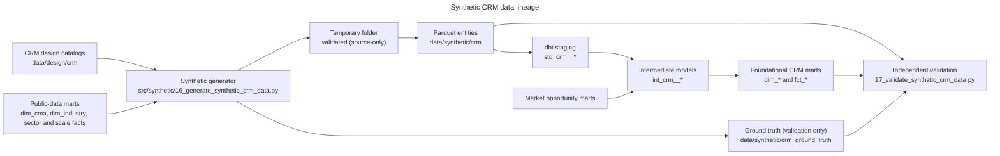

# Synthetic CRM data

> **Entirely synthetic data for a fictional bank.** Every business, lead, relationship manager (RM), assignment, activity,
> campaign and outcome below was generated by a program. None is a real customer, employee, business, contact, account or
> campaign, and no real bank's process, SLA, capacity or performance is described. All thresholds, SLAs, capacity values,
> specialist coverage and conversion outcomes are hypothetical simulation settings that await business approval; no rate
> here is a benchmark for any real Canadian bank.

## Purpose

This layer turns the hypothetical CRM acquisition design ([crm_acquisition_process_and_requirements.md](crm_acquisition_process_and_requirements.md),
[crm_data_model_and_dictionary.md](crm_data_model_and_dictionary.md)) into a deterministic, internally consistent operating
history. Later work can use it to develop lead prioritization, capacity-aware routing and acquisition-operations analytics.
It contains **no** lead-priority score, routing score, RM recommendation, assignment optimizer, dashboard or machine-learning model.

## Lineage



## Generation

- **Period:** 2025-06-01T00:00:00 (inclusive) to 2026-06-01T00:00:00 (exclusive), UTC. Event timestamps are stored as UTC;
  business-hour SLA clocks use each lead's province time zone (`local_time_zone`) and the synthetic calendar.
- **Generator version** 1.0.0, **master random seed** 20260929; every stage derives a fixed
  sub-seed from the master seed and a stage or record index, so identical inputs give identical files.
- **Mechanics:** a discrete-event simulation. Each lead moves through the approved lifecycle (transitions from
  `lead_transition_rules.csv`); RM leave, absence and departures, and nightly capacity snapshots (as of 00:00 UTC each national
  business day) are engine events. Routing replays the design's decision table (eligibility, preferences, exclusions, least-loaded
  with a deterministic tie-break, fallback queues, overrides). This logic is private to the generator and simulates hypothetical
  past behaviour; nothing it computes is written out as a score or recommendation.
- **Publishing:** the generator writes to `target/synthetic_crm_tmp`, runs the source-level validation, and only then replaces
  `data/synthetic/crm` and `data/synthetic/crm_ground_truth`. A failure publishes nothing and exits with code 1.
- **Settings:** every probability, share, cadence and outcome driver is in `synthetic_generation_parameters.csv`
  (133 parameters, all marked "simulation setting; not approved production policy"). Outcome drivers are declared there:
  size band, referral and RM-prospecting channels, stated credit interest, late first contact, and a per-lead latent engagement
  held only in ground truth. The market-context effect is declared as zero, so any later association between outcomes and market
  scores is not built in. Calibration changes made after early runs (conversion, contact success, cadence, staffing elasticity)
  are logged in `design_change_log.csv` with the reason.

### Regeneration

```powershell
powershell -ExecutionPolicy Bypass -File .\run_analytical_pipeline.ps1 -Scope CRMData
```

```powershell
C:/Users/abhij/anaconda3/python.exe src/synthetic/16_generate_synthetic_crm_data.py
```

## Entity inventory

| Entity | File | Grain | Key | Rows | First event | Last event |
|---|---|---|---|---|---|---|
| crm_business_prospect | crm_business_prospect.parquet | one row per synthetic business prospect | prospect_id | 15,566 | 2025-06-01 | 2026-05-31 |
| crm_lead | crm_lead.parquet | one row per lead | lead_id | 17,400 | 2025-06-01 | 2026-05-31 |
| crm_lead_source_touch | crm_lead_source_touch.parquet | one row per lead source touch | source_touch_id | 17,522 | 2025-06-01 | 2026-05-31 |
| crm_acquisition_channel | crm_acquisition_channel.parquet | one row per channel | channel_code | 5 | 2025-06-01 | 2025-06-01 |
| crm_campaign | crm_campaign.parquet | one row per campaign | campaign_id | 40 | 2025-06-01 | 2026-04-04 |
| crm_relationship_manager | crm_relationship_manager.parquet | one row per synthetic RM | rm_id | 140 | 2025-06-01 | 2026-02-10 |
| crm_territory | crm_territory.parquet | one row per territory | territory_id | 53 | 2025-06-01 | 2025-06-01 |
| crm_rm_territory | crm_rm_territory.parquet | one row per RM x territory x effective period | rm_territory_id | 407 | 2025-06-01 | 2026-02-10 |
| crm_rm_specialization | crm_rm_specialization.parquet | one row per RM x industry x effective period | rm_specialization_id | 44 | 2025-06-01 | 2025-11-07 |
| crm_rm_capacity_snapshot | crm_rm_capacity_snapshot.parquet | one row per employed RM x business day (national business calendar) | capacity_snapshot_id | 34,170 | 2025-06-02 | 2026-05-29 |
| crm_routing_decision | crm_routing_decision.parquet | one row per routing decision | routing_decision_id | 18,230 | 2025-06-01 | 2026-05-31 |
| crm_lead_assignment | crm_lead_assignment.parquet | one row per assignment | assignment_id | 18,560 | 2025-06-01 | 2026-05-31 |
| crm_lead_activity | crm_lead_activity.parquet | one row per activity | activity_id | 71,476 | 2025-06-02 | 2026-05-29 |
| crm_lead_status_history | crm_lead_status_history.parquet | one row per lead status change | status_history_id | 87,025 | 2025-06-01 | 2026-05-31 |
| crm_sla_event | crm_sla_event.parquet | one row per SLA clock instance per lead or assignment | sla_event_id | 119,429 | 2025-06-01 | 2026-05-31 |
| crm_duplicate_group | crm_duplicate_group.parquet | one row per duplicate group | duplicate_group_id | 936 | 2025-06-02 | 2026-05-31 |
| crm_opportunity_outcome | crm_opportunity_outcome.parquet | one row per opportunity (at most one per lead) | opportunity_id | 3,805 | 2025-06-05 | 2026-05-29 |
| crm_rule_version | crm_rule_version.parquet | one row per rule set x version | rule_version_id | 6 | 2025-06-01 | 2025-06-01 |
| synthetic_fsa_lookup | reference/synthetic_fsa_lookup.csv | one row per synthetic FSA | postal_fsa | 265 |  |  |

Hashes, generator version, seed and schema version for every file are in `data/synthetic/crm/synthetic_crm_manifest.csv`.
`synthetic_crm_run.json` holds the run timestamp only and is excluded from every hash comparison.

## Safe identifiers

Fixed-width fictional identifiers follow the approved dictionary patterns: `PRS-000001`, `SYN-BIZ-000001`, `LED-0000001`,
`TCH-0000001`, `RM-0001`, `RM-FICT-0001`, `ASG-0000001`, `ACT-0000001`, `LSH-0000001`, `SLE-0000001`, `RTD-0000001`,
`OPP-0000001`, `CMP-0001`, `DUPG-000001`, `CAPS-0000001`. Display values are obvious placeholders ("Synthetic Business 000123
Ltd.", "Synthetic RM 0042", "Campaign Synthetic 007 (fictional)"). Emails end in the reserved `.example` domain and telephone
numbers use the fictional 555-01xx range. No library that could produce real-looking personal data was used.

## Volumes and rates

The volume specification ranges are met for every entity (see `entity_inventory.csv`). The five declared rates:

| Rate | Value | Range | Denominator |
|---|---|---|---|
| duplicate rate | 5.0% | 4%-7% | all leads |
| invalid-lead rate | 3.4% | 3%-6% | all leads |
| reassignment rate | 11.7% | 8%-14% | leads with at least one primary RM assignment |
| first-contact SLA-breach rate | 12.4% | 10%-18% | SLA-06 clocks that are closed or breached |
| lead-to-conversion rate | 10.6% | 6%-12% | valid leads (not INVALID or MERGED), including leads still open at the cut-off |

The conversion rate includes leads that are still open at the cut-off, so recent cohorts are immature by construction.

## Coverage

- **Channels:** CH-BRN 1,884, CH-DIG 8,954, CH-MKT 3,160, CH-PTR 1,291, CH-RMP 2,111.
- **Geography:** all 41 CMAs are represented (59 to 3696 leads each, median 121); conflict 95, missing 70, out_of_footprint 118, resolved_cma 15,193, resolved_province_remainder 1,924. Market-evidence
  flags: full_framework 14,821, no_market_context 2,112, scale_only_limited_evidence 467. Tier 3 leads keep their CMA, the `scale_only_limited_evidence` flag and scale-only context, with NULL
  opportunity score and rank in `int_crm__lead_market_context`; leads without a CMA carry `no_market_context` and are still routed.
- **Size bands (leads):** 1-4 7,293, 100-499 830, 20-99 2,957, 5-19 6,206, 500-plus 113, unknown 1. Industry keys come from `analytics.dim_industry` (NAICS 2022 sectors weighted by each CMA's
  SME composition), with controlled unclassified, missing-then-corrected, public-administration (excluded) and specialist cases.
- **RMs:** 140 fictional RMs; 20 dedicated specialists (agriculture and commercial real estate, regional and national),
  24 generalists with a secondary specialization, 6 leavers and 6 joiners during the period.
- **Capacity (RM business days):** states approved_exception 22, at_or_above_hard_limit 382, below_warning 31,179, unavailable 2,043, warning 544; availability available 30,490, partial 1,637, planned_leave 1,524, unavailable 519. Utilization quantiles (10/50/90/99%):
  0.03, 0.13, 0.48, 1.03. The 40-point base capacity is a pending-approval synthetic parameter, not a real standard;
  under it most RM-days sit below the warning level, and capacity pressure concentrates in the leaner large-market territories.
- **SLA clocks:** outcomes breached_closed 5,002, breached_open 17, met 113,208, not_applicable 26, open 1,096, warning_open 80; 2,018 paused clocks and 1,094 clocks escalated to level 2. SLA-06A and SLA-06C
  are never used because every lead carries the default priority band P2 (A-009) until a priority model exists.
- **Duplicates:** groups by tier exact 525, high_confidence 204, review 207. Only exact and high-confidence matches merge automatically; review matches merge only
  when confirmed. Merged leads' source touches move to the survivor with their original lead id, channel and timestamp.

## Scenario coverage

All 33 approved scenarios are detected from observable data (not from labels) and meet their declared minimum counts.
Indicative shares are reported only; several differ from the design's indicative ranges because scenarios overlap and
because the rates above, not the shares, are the declared constraints.

| Scenario | Name | Leads | Minimum | Share | Indicative | Ground-truth agreement |
|---|---|---|---|---|---|---|
| SC-01 | Clean digital lead assigned successfully | 5652 | 25 | 32.48% | 25-35% | 1.000 |
| SC-02 | Branch referral | 1727 | 25 | 9.93% | 8-12% | 1.000 |
| SC-03 | Marketing-campaign response | 2838 | 25 | 16.31% | 15-20% | 1.000 |
| SC-04 | Partner referral | 1168 | 25 | 6.71% | 5-8% | 1.000 |
| SC-05 | RM-prospected lead | 1951 | 25 | 11.21% | 8-12% | 1.000 |
| SC-06 | Incomplete lead requiring validation | 614 | 25 | 3.53% | 5-8% | 1.000 |
| SC-07 | Invalid or ineligible lead | 598 | 25 | 3.44% | 3-6% | 1.000 |
| SC-08 | Exact duplicate | 729 | 25 | 4.19% | 2-4% | 1.000 |
| SC-09 | Probable duplicate requiring review | 140 | 25 | 0.80% | 2-3% | 1.000 |
| SC-10 | Unassigned lead | 141 | 25 | 0.81% | 3-5% | 1.000 |
| SC-11 | Overloaded RM | 3865 | 25 | 22.21% | 4-6% | 0.650 |
| SC-12 | RM temporarily unavailable | 309 | 20 | 1.78% | 1-2% | 1.000 |
| SC-13 | Territory mismatch | 556 | 20 | 3.20% | 2-3% | 0.433 |
| SC-14 | Industry-specialist mismatch | 4238 | 20 | 24.36% | 2-3% | 1.000 |
| SC-15 | Explicitly stated service language | 1143 | 25 | 6.57% | 3-5% | 1.000 |
| SC-16 | Assignment acknowledgement delay | 531 | 25 | 3.05% | 2-4% | 1.000 |
| SC-17 | First-contact SLA breach | 1892 | 25 | 10.87% | 10-18% | 0.981 |
| SC-18 | Repeated failed contact attempts | 1194 | 25 | 6.86% | 5-8% | 1.000 |
| SC-19 | Inactivity escalation | 495 | 25 | 2.84% | 3-5% | 0.950 |
| SC-20 | Automatic reassignment | 1234 | 25 | 7.09% | 3-5% | 0.994 |
| SC-21 | Manager-approved manual override | 265 | 20 | 1.52% | 1-3% | 1.000 |
| SC-22 | Lead nurturing | 578 | 25 | 3.32% | 8-12% | 1.000 |
| SC-23 | Qualified opportunity | 3805 | 25 | 21.87% | 15-25% | 1.000 |
| SC-24 | Successful conversion | 1696 | 25 | 9.75% | 6-12% | 1.000 |
| SC-25 | Closed-lost lead | 8521 | 25 | 48.97% | 20-30% | 1.000 |
| SC-26 | Lead withdrawn | 309 | 25 | 1.78% | 2-4% | 1.000 |
| SC-27 | Out-of-CMA lead | 1744 | 25 | 10.02% | 8-12% | 1.000 |
| SC-28 | Tier 3 market lead | 428 | 25 | 2.46% | 2-4% | 1.000 |
| SC-29 | Missing market-opportunity context | 1761 | 25 | 10.12% | 8-12% | 1.000 |
| SC-30 | Capacity-boundary case | 295 | 10 | 1.70% | 1-2% | 0.824 |
| SC-31 | Multiple historical assignments, one active | 231 | 25 | 1.33% | 3-5% | 1.000 |
| SC-32 | Attribution preserved after duplicate merge | 572 | 25 | 3.29% | 1-3% | 1.000 |
| SC-33 | Audited reopening of a closed-lost lead | 122 | 40 | 0.70% | 0.5-1% | 1.000 |

Ground-truth agreement is the Jaccard overlap between the observable predicate and the generator's label; the 13 scenarios whose
definitions are directly observable must match exactly.

## Ground truth

`data/synthetic/crm_ground_truth` holds the generator's labels: each lead's primary scenario and scenario memberships, arrival kind,
latent engagement, planned path, injected process issues, expected outcome, the true relationship between similar prospects and
the RMs excluded at the hard limit in each routing decision. It is not a dbt source, never feeds a model and is read only by the
validator. Tests check that no CRM table or model contains a ground-truth, score or recommendation column.

## dbt structure

| Layer | Models | Notes |
|---|---|---|
| Sources | `synthetic_crm` (18 Parquet entities), `crm_design` (8 catalogs read as text) | `models/sources/_crm_sources.yml` |
| Staging | 18 `stg_crm__*` views | Typed exactly as the field dictionary; keys, required values, accepted values and relationships tested |
| Intermediate | `int_crm__lead_current_status`, `int_crm__active_assignment`, `int_crm__lead_assignment_history`, `int_crm__lead_activity_timeline`, `int_crm__lead_sla_history`, `int_crm__rm_capacity_at_assignment`, `int_crm__duplicate_resolution`, `int_crm__lead_market_context` | Relationships and lifecycle only |
| Marts | `dim_relationship_manager`, `dim_acquisition_channel`, `dim_campaign`, `dim_business_prospect`, `dim_crm_territory`, `fct_lead`, `fct_lead_status_history`, `fct_lead_assignment`, `fct_lead_activity`, `fct_routing_decision`, `fct_rm_capacity_snapshot`, `fct_sla_event`, `fct_opportunity_outcome`, `fct_lead_source_touch` | Source grains preserved; fictional contact fields excluded |

Everything is tagged `crm_data`: the base-layer and opportunity-framework steps exclude the tag, so their counts (151 and 39 tests)
are unchanged. The CRM layer has 19 singular tests in `tests/crm/` plus generic tests on every staging, intermediate and mart model.

## Validation

`src/validation/17_validate_synthetic_crm_data.py` recomputes everything independently of the generator:
230 of 230 checks pass (evidence in `data/validation/synthetic_crm/`). It checks the
manifest and hashes, schema against the dictionary, foreign keys (including `dim_cma`, `dim_industry`, `dim_size_band`), temporal
order, every status transition, assignment history, overrides, duplicates and attribution. It recomputes SLA targets, warnings,
outcomes and elapsed business minutes on its own business calendar, and capacity from assignments, lead statuses and nurture dates.
It also covers scenarios, rates, privacy, dbt source and staging reconciliation, model grains and upstream design integrity.

**Mutation tests** (temporary copies only): 10 of 10 injected faults are
detected, each by its specific target check, and the published files are unchanged afterwards:

| Injected fault | Table | Check that must fail |
|---|---|---|
| duplicate primary key | crm_lead | primary keys are unique and not null |
| broken foreign key | crm_lead_activity | all foreign keys resolve |
| invalid status transition | crm_lead_status_history | every status change uses an allowed transition |
| impossible event timestamp | crm_lead_activity | activities occur while their assignment is active |
| multiple active assignments | crm_lead_assignment | at most one active primary assignment per lead |
| missing override reason | crm_lead_assignment | manual overrides have a reason code and actor role |
| real-looking email domain | crm_lead | emails use reserved .example domains only |
| leaked ground-truth field | crm_lead | operational tables contain only dictionary columns and no ground-truth fields |
| missing required scenario | crm_lead | all 33 approved scenarios are observable |
| out-of-range conversion rate | crm_lead | lead-to-conversion rate within |

**Reproducibility:** two clean generator runs produce 25 of 25 business-data files
byte-identical to each other and to the published data (Parquet written with an explicit schema, fixed compression and row-group
size, sorted rows and no timestamps in data values).

## Limitations

- Everything is simulated; distributions reflect declared settings, not observed behaviour. Relationships between inputs and
  outcomes exist only where declared in the parameters catalog.
- Capacity starts empty on 2025-06-01 and builds up over the first months; early-period utilization is low by construction.
- The synthetic postal-prefix lookup (`reference/synthetic_fsa_lookup.csv`) is not an official conversion file.
- Late-period leads are immature at the cut-off (open clocks and open opportunities).
- The indicative scenario shares in the design are not all met; they overlap and are reported, not enforced.
- The approval-pending assumptions (calendar, SLA durations, 40-point capacity, specialist coverage and others) are used as
  configurable defaults only.
- The SLA-event volume range in the volume specification was changed from 65,000-95,000 to 90,000-130,000 after calibration runs
  showed that the SLA catalog opens a clock at every attempt and follow-up. The change is logged in `design_change_log.csv` and
  needs approval; the 119,429 generated clocks are outside the originally approved range.
- Several settings were recalibrated after early runs because a declared constraint failed (conversion, contact success,
  follow-up cadence, and staffing elasticity 0.85 to 0.60 to 0.45 so that capacity scenarios appear). Each change is logged.
- Specialist-mismatch is high (about 70% of specialist-need
  decisions) because preferred-industry specialists are sparse; mandatory industries go to specialists or the national pool.
- Some ground-truth labels are derived after the run from the generator's own records (for example acknowledgement-delay
  membership from clock outcomes, and expected final status), so their agreement with the observable predicates is partly circular.
